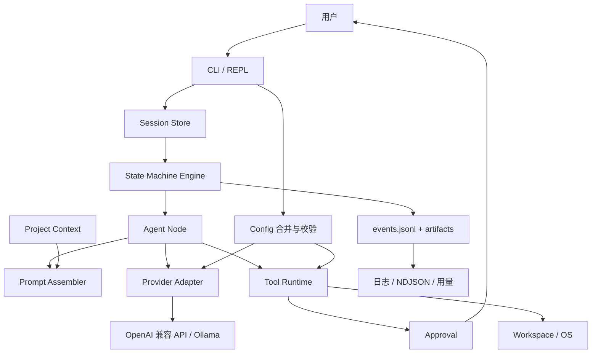

> 总览 · [返回索引](../README.md) · [下一模块](01-cli.md)

# 总览与架构

## 0. 阅读指南与术语

### 0.1 阅读方式

- 第 1～3 章回答“ant 是什么、怎么用”。
- 第 4～6 章定义配置、模型与 prompt 三个输入面。
- 第 7～10 章定义执行面：节点、状态机、会话、工具。
- 第 11～15 章定义横切能力：上下文、安全、容错、项目初始化、可观测性。
- 第 16～17 章约束实现与测试；第 18～20 章提供追溯、决策与示例；第 21 章给出各模块对外接口与串联方式。

每个设计点后以 `> **设计理由**` 与 `> **备选方案**` 说明取舍；关键决策汇总在 [§19](17-adr.md#19-设计决策记录adr)。

### 0.2 术语

| 术语 | 定义 |
| --- | --- |
| Workspace | 当前工作目录；所有 session、配置、项目上下文都以它为根 |
| Session | 一次可续的工作上下文，存放在 `<workspace>/.ant/sessions/<id>/` |
| Turn | 一次用户输入到 agent 完成回复（可能包含多个节点与多轮工具调用） |
| Step | 状态机中的一次节点执行，或一次 fan-out 组 |
| Node | 拥有独立 system prompt、工具权限、输出契约的执行单元 |
| Mode | 状态机图；取值为 `code`、`plan`、`ask`、`council` |
| Tool call | 模型返回的 `tool_calls[]` 中的一项，带唯一 `id` |
| Tool result | 工具执行结果；必须与 `tool_call_id` 一一对应 |
| Artifact | 大体积工具输出、计划、渲染后的节点输入等，存放在 session 的 `artifacts/` |
| Approval | 用户对越界或高风险操作的显式授权 |
| Provider | 某一 API 协议的适配器，如 `openai-completions`、`otter` |
| Model alias | `models[].name`，全局唯一，供 `-p`、`defaultModel`、`nodeModels` 使用 |
| Compaction | 上下文超限时对历史消息做摘要/截断的过程 |
| Project context | 自动生成并缓存的 `.ant/project.md` |
| Plan gate | plan 模式验证通过后，询问用户是否切换到 code 模式执行的确认点 |
| 副作用工具 | 会改变外部状态的工具：`write`、`edit`、`bash`（可能） |

### 0.3 需求与决策编号

- 需求编号示例：`R-CLI-03`、`R-TOOL-07`。
- 决策编号示例：`D-12`，在正文首次出现处标注，在 [§19](17-adr.md#19-设计决策记录adr) 汇总。
- 追溯矩阵（[§18](16-traceability.md#18-需求追溯矩阵)）把原始 README 的每一节映射到本文档章节与决策编号。

> **设计理由**：原始 README 把需求、示例、问题和设想混在一起，无法判断“哪些已经定了”。先建立术语和编号，后续每个设计点才能被引用、验收和追溯。
>
> **备选方案**：直接在原文上追加段落（未采用：冲突项会同时存在两份互相矛盾的描述）。

---

## 1. 项目定位、设计原则与非目标

### 1.1 定位

`ant` 是一个运行在终端里的本地 AI 编码代理：

- 接受自然语言任务，调用模型与本地工具完成代码阅读、修改、验证。
- 用状态机组织多个 agent node，而不是单轮问答。
- 每个 session 可持久化、可中断、可断点续传。
- 支持多个 OpenAI 兼容 provider 与本地 Ollama，并允许按节点选择模型。

### 1.2 设计原则

| 原则 | 含义 | 落地方式 |
| --- | --- | --- |
| 显式状态、可恢复 | 任何时刻都能回答“执行到哪、下一步是什么、上次为什么停” | session 事件日志 + 状态机 checkpoint（[§9](07-session.md#9-session-与断点续传)） |
| 契约化 | 节点、工具、provider、配置都有可校验的输入输出契约 | JSON Schema + 结构化输出（[§5](03-models.md#5-模型与-provider)、[§7](05-nodes.md#7-agent-node)、[§10](08-tools.md#10-工具系统)） |
| 最小权限 | 非 code 节点不能改文件；越界操作必须审批 | 节点权限矩阵 + 审批分级（[§7](05-nodes.md#7-agent-node)、[§12](10-security.md#12-安全与审批)） |
| 成本可控 | 不让 agent 无限循环或把巨型输出塞回模型 | 轮次上限、超时、截断、压缩、预算（[§10](08-tools.md#10-工具系统)、[§11](09-context.md#11-上下文与-token-管理)、[§13](11-fault-tolerance.md#13-容错重试与幻觉控制)） |
| 缓存友好 | 稳定内容在前、易变内容在后，最大化 provider 前缀缓存 | prompt 分层（[§6](04-prompt.md#6-prompt-体系)） |
| 用户可控 | 高风险动作必须由人确认；“all”只限本 session | HITL + 审批作用域（[§12](10-security.md#12-安全与审批)） |
| 可观测 | 每个模型请求、工具调用、token 消耗都可追溯 | 事件日志 + NDJSON + turn 摘要（[§15](13-observability.md#15-可观测性与成本)） |
| 跨平台 | macOS、Linux、Windows 行为一致 | 纯 Go、无 CGO、按 OS 选择 shell（[§16](14-engineering.md#16-工程实现约束)） |

### 1.3 非目标

- 多用户、服务端部署、Web GUI。
- 团队协作、云端 session 同步、共享记忆。
- 自动创建 PR、自动发布。
- 内置向量库/RAG（先用 `read_code`、`search` 和项目上下文解决）。
- MCP、插件市场、第三方工具动态加载（v1 不提供，工具注册表预留扩展点）。
- OS 级强沙箱（v1 用路径校验 + 审批 + 硬拒绝清单，残余风险见 [§12.8](10-security.md#128-残余风险明确声明)）。

### 1.4 约束

- 单用户、本地文件系统；`workspace` 默认为当前工作目录。
- 模型通过 HTTP(S) 访问；离线模式不在 v1 范围。
- `read_code` 以 Go 为首要支持语言；其他语言先用 `read`/`search`。
- Provider 以 OpenAI 兼容协议为主；`otter` 适配器缺少公开协议，按实验性处理（[§5.6](03-models.md#56-otter-适配器)）。

> **设计理由**：一个编码 agent 的风险主要来自“会改文件、会执行命令”，所以“最小权限 + 审批 + 可恢复”必须写进设计原则，而不是事后补。明确非目标可以避免把 v1 拖成通用 agent 平台。
>
> **备选方案**：先做单轮 chat（未采用：无法满足原始需求中的多节点状态机与验证闭环）。

---

## 2. 系统架构与数据流

### 2.1 组件

| 组件 | 职责 | 对外契约 |
| --- | --- | --- |
| CLI | 解析命令与参数、交互、渲染 | [§3](01-cli.md#3-cli-规格) |
| Config | 加载 home/workspace 配置、合并、校验 | [§4](02-config.md#4-配置系统) |
| Provider | 将统一请求映射到具体 API，解析流式响应 | [§5](03-models.md#5-模型与-provider) |
| Prompt Assembler | 按稳定性顺序拼装节点 prompt | [§6](04-prompt.md#6-prompt-体系) |
| Agent Node | 单个节点的工具循环与输出契约 | [§7](05-nodes.md#7-agent-node) |
| State Machine | 模式图、转移条件、轮次与预算 | [§8](06-state-machine.md#8-状态机与模式) |
| Session Store | 事件日志、meta、artifact、锁、恢复 | [§9](07-session.md#9-session-与断点续传) |
| Tool Runtime | 工具注册、参数校验、执行、截断、审批 | [§10](08-tools.md#10-工具系统) |
| Approval | 风险分类与用户确认 | [§12](10-security.md#12-安全与审批) |
| Context Manager | token 预算、压缩、缓存布局 | [§11](09-context.md#11-上下文与-token-管理) |
| Project Context | 扫描与生成 `.ant/project.md` | [§14](12-project-context.md#14-项目级上下文自动初始化) |
| Observability | 日志、NDJSON、用量与成本 | [§15](13-observability.md#15-可观测性与成本) |

### 2.2 架构图

### 2.3 外部契约面

实现前必须冻结以下契约；本文档是它们的规范来源：

1. **CLI 语法与退出码**（[§3](01-cli.md#3-cli-规格)）。
2. **配置 schema**：`models.json`、`settings.json`（[§4](02-config.md#4-配置系统)、[§5](03-models.md#5-模型与-provider)）。
3. **Session schema**：`meta.json`、`events.jsonl`、artifact 引用（[§9](07-session.md#9-session-与断点续传)）。
4. **工具 schema**：名称、参数、返回值、错误、权限（[§10](08-tools.md#10-工具系统)）。
5. **节点输出契约**：`verifier`、`deliberate`、`aggregation` 的结构化 JSON（[§7](05-nodes.md#7-agent-node)）。
6. **Provider 接口**：请求/响应/流式/错误分类（[§5](03-models.md#5-模型与-provider)）。
7. **模式与状态机语义**：图、轮次、终止条件（[§8](06-state-machine.md#8-状态机与模式)）。

> Go 包内部的公开 API 不作为承诺；`pkg/` 目录在 v1 保持为空，避免过早固定库接口。
>
> `internal/` 包之间的对接面（接口、组合根、调用链）见 [§21 模块接口与串联](19-interfaces.md#21-模块接口与串联实现契约)。

### 2.4 端到端数据流

1. CLI 解析参数，`Config` 加载 `$ANT_HOME` 与 `<workspace>/.ant` 并逐键合并、校验。
2. CLI 选择 session：续最近一个、`-s` 指定、或 `--new` 新建；获取 session 锁。
3. 选择模式与模型；若为新建且缺少项目上下文，触发 `.ant/project.md` 生成（[§14](12-project-context.md#14-项目级上下文自动初始化)）。
4. 状态机进入首个 step；`Prompt Assembler` 组装稳定前缀、摘要、最近消息与运行时信息。
5. Provider 发起流式请求；文本增量直接渲染，`tool_calls` 按 `index` 累积，结束后统一解析。
6. Tool Runtime 校验参数 → 审批（如需要）→ 并发/串行执行 → 截断/落 artifact → 按 `id` 回填 tool 消息。
7. 节点完成，解析输出契约；状态机根据 `pass/fail` 转移到下一节点或回退。
8. 每个事件追加写入 `events.jsonl`；token 用量写入事件与 `meta.json`。
9. Turn 结束：更新 session 状态，打印摘要与费用；等待下一次输入或退出。
10. 恢复时：取锁 → 读 meta/events → 丢弃尾行不完整 JSON → 折叠事件重建状态 → 修复工具消息配对 → 从断点继续。

### 2.5 持久化边界

| 数据 | 位置 | 是否可提交 git |
| --- | --- | --- |
| 模型与设置 | `.ant/models.json`、`.ant/settings.json` | 可以，但密钥必须用环境变量 |
| 用户 prompt | `.ant/prompt.md`、`.ant/prompts/*.md` | 可以 |
| 项目上下文 | `.ant/project.md`、`.ant/project.meta.json` | 可以（不含密钥） |
| Session 事件与产物 | `.ant/sessions/` | 不应该（含对话与代码片段） |
| 日志 | `.ant/logs/` | 不应该 |

> **设计理由**：断点续传、可观测性和成本统计都依赖同一份事件流，因此把 session 存储放在架构中心，而不是附属功能。把契约面单独列出，可以让实现和测试围绕稳定接口推进。
>
> **备选方案**：把状态只放内存，退出即丢（未采用：与“断点续传”需求冲突）。

---

[返回索引](../README.md) · [下一模块](01-cli.md)
