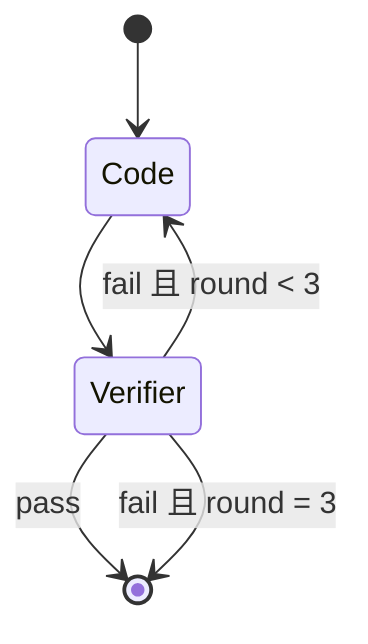
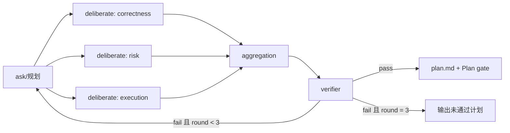
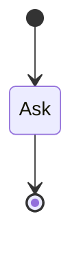
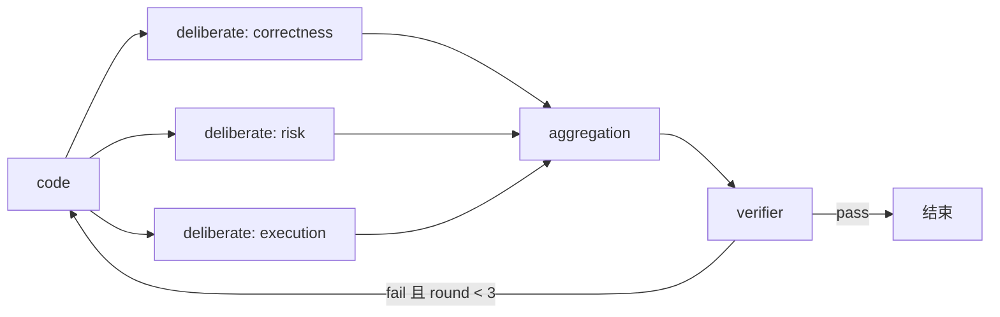

> 模块 6 / 18 · [返回索引](../README.md) · [上一模块](05-nodes.md) · [下一模块](07-session.md)

# 8. 状态机与模式

## 8.1 引擎语义

- 一个模式是一张有向图；节点是顶点，转移条件来自结构化输出或引擎计数。
- 每次节点执行（或 fan-out 组）是一个 step；step 完成即写 checkpoint。
- 轮次（round）按“回到入口节点”计数，用于限制循环。
- 预算在 turn 开始时初始化：工具轮数、token、节点超时、模式轮次。
- 用户中断时写 `session_interrupted`，保留当前 step 的输入/输出，恢复时继续。
- 已完成 step 不重跑；模型调用失败可重试，副作用工具不重放。
- 任一模式都不得“无限重试直到成功”。

## 8.2 code 模式（默认）



流程：

1. `code` 节点接收用户请求，使用工具完成修改。
2. `verifier` 按 [§8.7](#87-验证标准) 的验证标准执行检查，输出 verdict。
3. `pass=true` → 输出摘要，退出码 0。
4. `pass=false` 且 `round < 3` → 把 failures 作为 `Feedback` 传给 `code`，进入下一轮。
5. `round = 3` 仍失败 → 输出失败报告，退出码 1。

**无进展检测**：某一轮 `code` 没有产生任何 `write`/`edit` 调用，且 verifier 失败 → 立即中止并说明“未产生修改，继续循环无意义”。这条规则防止“模型反复解释但不改代码”。

## 8.3 plan 模式



流程：

1. `ask` 作为规划者：读取必要代码，产出计划草稿（[§7.4.4](05-nodes.md#744-code-ask)）。
2. 三个 `deliberate` 并发找问题。
3. `aggregation` 去重、定级、合并，保留 provenance。
4. `verifier` 验证计划是否可行、是否覆盖需求、是否有验收方式。
5. pass → 写 `plan.md`，交互式询问是否进入 code 模式执行；非交互打印路径并以 0 退出。
6. fail 且 `round < 3` → 把聚合问题与 verifier failures 传回 `ask` 重新规划。
7. `round = 3` 仍失败 → 输出“未通过的计划 + 未解决问题”，退出码 1。

**Plan gate**：

- 交互式：`是否进入 code 模式执行该计划？[y/N]`；`y` 在同一 session 内切换模式（保留历史与 plan），`N` 结束。
- 非交互：不进入 code；用户可稍后运行 `ant -m code` 并在需要时确认切换。
- plan 模式本身**不允许** `write`/`edit`；只读工具可检查代码。bash 的源码修改命令需要审批（[§7.3](05-nodes.md#73-权限矩阵)），且不会被当作计划的一部分。

## 8.4 ask 模式



- 单节点回答；只读工具（read/read_code/search/bash 只读用途/ask）。
- 不修改文件；不进入 verifier。
- 输出必须给引用；无法读取时明确说明。
- 退出码 0（回答完成）。

## 8.5 council 模式



- 与 code 模式的区别：在 verifier 之前增加三方对抗评审，适合复杂/高风险任务。
- `code` 修改后，三个 deliberate 审阅当前改动与问题；aggregation 合并；verifier 验证。
- fail → 把 issues 传回 `code`；最多 3 轮；无进展检测同样适用。
- 成本高于 code 模式，文档明确提示用户按需选择。

## 8.6 模式切换

- 允许在 turn 边界或 Plan gate 切换。
- 切换写 `mode_changed` 事件，记录 from/to、原因、用户确认。
- 保留历史消息、plan、artifact；重置当前模式的轮次与预算。
- `-m` 指定不同模式时：交互确认；非交互以退出码 2 报错，要求显式 `--new` 或先交互切换。
- 不在节点执行中途切换，避免半完成 step 的状态不一致。

## 8.7 验证标准

`verifier` 按以下优先级选择检查：

1. 用户本轮明确给出的验收规则（prompt 中声明）。
2. `.ant/project.md` 中记录的构建/测试/lint 命令。
3. 语言/项目常识：Go 项目默认 `go build ./...`、`go test ./...`、`go vet ./...`。
4. 若以上都没有：做静态一致性检查，并在 verdict 中说明“未执行自动化验证”。

规则：

- 每条 `checks` 必须记录实际命令与退出码；不得伪造。
- 超时/环境缺失（如没有 go 命令）不算“通过”，记为 failure 并说明原因。
- 只读节点可以执行只读命令；构建/测试命令本身可能写缓存，但仍属于验证用途，不触发文件审批（workspace 内）。

## 8.8 plan.md 格式

最终计划写入 `.ant/sessions/<id>/plan.md`；每轮草稿写入 `artifacts/plan/round-<n>.md`。

```markdown
# Plan: <标题>

> session: <id> · mode: plan · round: <n> · model: <alias> · generated: <UTC>

## 目标
## 范围（含明确不做）
## 现状与约束
## 实施步骤
## 风险与缓解
## 验证与验收
## 未决问题
```

- 通过验证后保留 `plan.md` 作为可执行依据；未通过则写 `plan.draft.md` 并标注未解决问题。
- plan 中引用的文件路径必须是 workspace 相对路径。

## 8.9 终止条件与退出码

| 情况 | 行为 | 退出码 |
| --- | --- | --- |
| 模式成功（含 plan 通过） | 打印摘要 | 0 |
| 达到轮次上限仍失败 | 打印失败点与续跑命令 | 1 |
| 无进展中止 | 打印原因 | 1 |
| 用户中断 | checkpoint，提示续跑 | 3 |
| 需要审批/提问但非交互 | 打印缺失授权 | 4 |
| Provider 最终失败 | 打印错误分类与修复建议 | 5 |
| 配置/用法错误 | 打印用法或配置位置 | 2 |

> **设计理由**：原始需求只画了流程，没有回答“失败几次停、什么算通过、plan 输出到哪、怎么进入执行”。不定义这些，agent 会烧 token 且无法验收。Plan gate 把“计划”和“执行”分开，符合人类审阅习惯，也避免 plan 模式意外改代码。
>
> **备选方案**：plan 验证通过自动进入 code（未采用：用户失去对高风险执行的最后确认）；plan 与 code 完全独立 session（未采用：丢失上下文与计划关联）。

---

[返回索引](../README.md) · [上一模块](05-nodes.md) · [下一模块](07-session.md)
