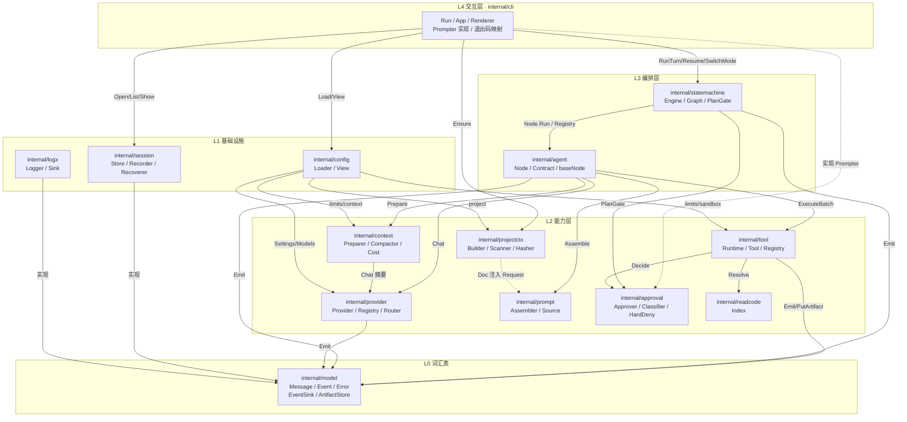
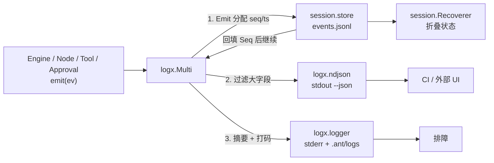
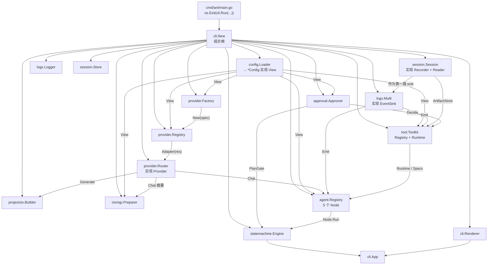
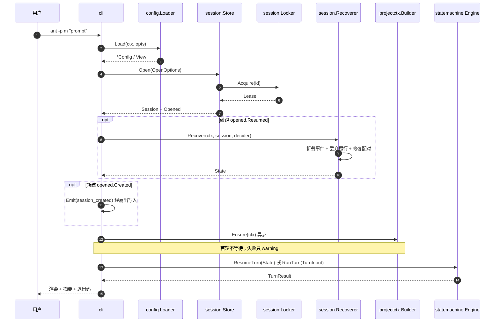
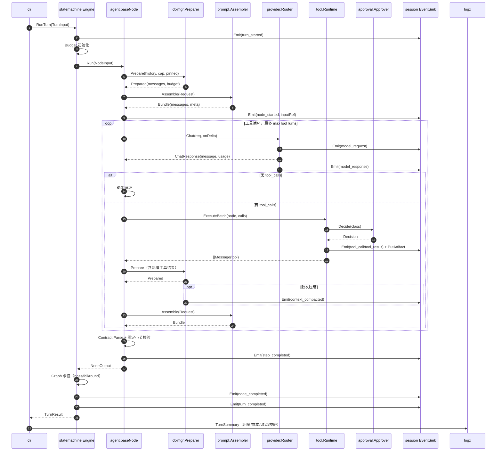
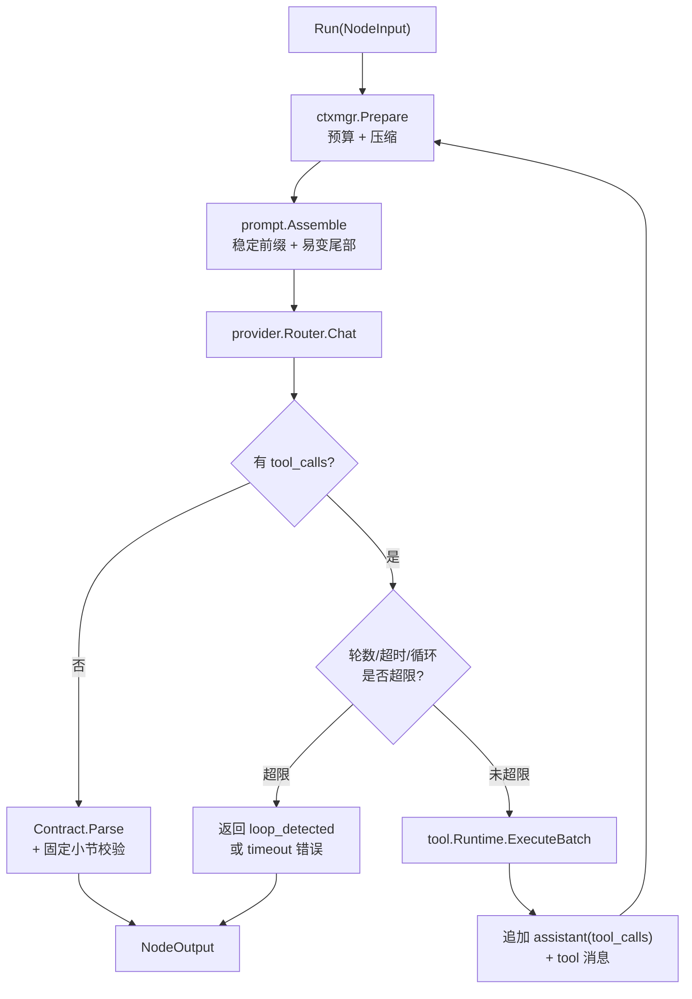
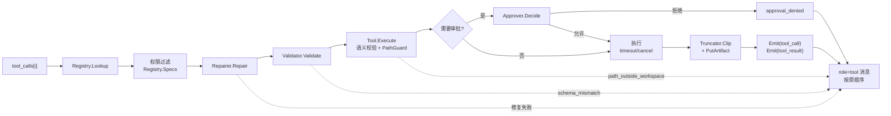
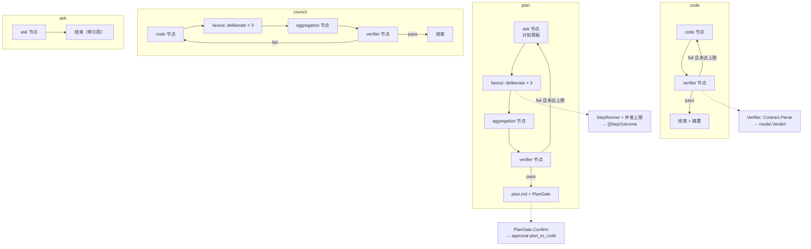
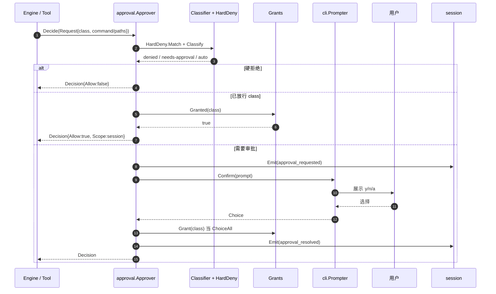
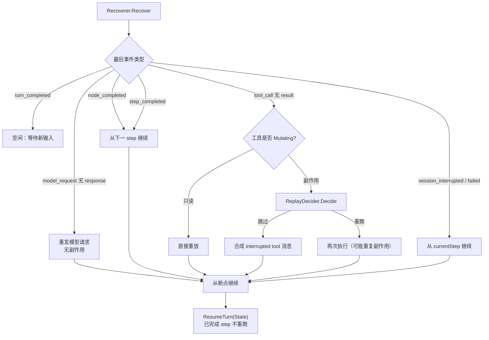

> 模块 19 / 19 · [返回索引](../README.md) · [上一模块](18-appendix.md)

# 21. 模块接口与串联（实现契约）

本文回答三个问题：**每个模块对外暴露什么接口、由谁实现、按什么顺序串联**。它是 [§1–§20](00-overview.md) 行为契约在代码边界上的投影，也是实现阶段的“骨架图”。

> **编号说明**：本文件是第 19 号文档，但为避免重排既有 §1–§20 与大量交叉引用，正文采用 §21 编号并排在附录之后。阅读顺序上可视其为“实现契约附录”；内容优先级与其余模块相同。

**边界声明**：这里的接口是 `internal/` 包之间的**内部契约**，不是 `pkg/` 公共 API（[D37](17-adr.md#19-设计决策记录adr)）。它们可以被重构，但同一版本内必须保持一致：改接口 = 改文档 + 改 ADR，见 [§16.5](14-engineering.md#165-版本与兼容)。

**阅读顺序**：21.1–21.2 总览与接口清单 → 21.3–21.14 逐模块接口 → 21.15 组合根装配 → 21.16 七条调用链（全部图集中在此）→ 21.17–21.20 错误归属、测试替身、扩展点与映射。只关心“怎么串起来”的读者可直接跳到 21.15/21.16。

## 21.1 接口设计规则

| # | 规则 | 落地 | 违反后果 |
| --- | --- | --- | --- |
| R1 | 接口由**使用方**定义（consumer-side） | `provider`、`tool` 等被依赖方不 import 上层；调用方声明自己需要的最小方法集 | 循环依赖、测试必须构造整棵依赖树 |
| R2 | 一个接口只服务一类调用方 | 读侧 `Reader` 与写侧 `Recorder` 分开；`Tool` 与 `Runtime` 分开 | 大接口导致 fake 膨胀，谁都能改状态 |
| R3 | 横切词汇集中在 `internal/model` | `Message`、`ToolCall`、`Usage`、`Event`、`Error` 只有一份 | 同一概念多份拷贝，转换层到处漏 |
| R4 | 所有外部副作用经接口 | 文件、网络、时钟、进程、终端（`Prompter`）、随机数 | 无法做 [§17.2](15-testing.md#172-fake-provider) 的无网络测试 |
| R5 | 失败走返回值，不 panic | 错误带 `Class`/`Code`/`Hint`（[§13.1](11-fault-tolerance.md#131-错误分类)、[§10.4](08-tools.md#104-参数校验与类型转换)） | 一个坏参数炸掉整个 turn |
| R6 | 取消只靠 `context.Context` | 阻塞方法第一个参数必须是 `ctx`；取消不写“半条”事件 | Ctrl-C 后状态机与事件日志不一致 |
| R7 | 每个接口至少有生产实现 + 测试实现 | 见 21.18 测试替身矩阵 | 集成测试只能连真实 API |
| R8 | 接口不承载策略常量 | 限额、优先级、审批分级来自 `config.View` | 策略散落，无法按项目覆盖（[D6](17-adr.md#19-设计决策记录adr)） |

**依赖方向（[§16.1](14-engineering.md#161-建议包结构)）**：`cli → statemachine → agent → {provider, prompt, context, tool, session, projectctx} → {model, config, logx}`。接口可以打破“必须向下”的形式限制，但**运行时依赖**不得反向：下层不允许调用上层的 `Run`/`SwitchMode`。

> **设计理由**：这 8 条是“能并行开发 + 能单独测试 + 能换实现”的最低条件。特别是 R1/R2：如果先写一个大接口再往里加方法，所有 fake 都要跟着改，测试会先于功能腐烂。
>
> **备选方案**：按包各定一个 `Service` 大接口（未采用：等于没有边界，且无法 fake）；用 DI 框架（未采用：反射注入让依赖关系不可读，与 [D42](17-adr.md#19-设计决策记录adr) 的“显式装配”冲突）。

## 21.2 接口全景

**图 21-1 分层与接口边界**



**接口清单**（速查；签名见各节）：

| 包 | 接口 | 一句话职责 | 生产实现 | 主要调用方 |
| --- | --- | --- | --- | --- |
| `model` | `EventSink` | 写一条事件（含 seq 分配） | `session.store`、`logx.ndjson`、`logx.multi` | 几乎所有模块 |
| `model` | `ArtifactStore` | 落大内容并返回引用 | `session.store` | `tool`、`agent`、`context` |
| `config` | `Loader` | 读 home/workspace、逐键合并、校验 | `config.loader` | `cli` |
| `config` | `View` | 只读、已合并、可溯源、已打码 | `*config.Config` | 所有组装方 |
| `provider` | `Provider` | 一次对话请求（流式/非流式归一化） | `provider/openai`、`provider/otter` | `provider.Router`、`context.summarizer` |
| `provider` | `Registry` | 别名解析 + 能力查询 + 节点模型选择 | `provider.registry` | `agent.baseNode`、`cli`、`provider.Router` |
| `provider` | `Router` | 别名 → 适配器，对 agent 暴露单一 `Provider` | `provider.router` | `agent.baseNode` |
| `provider` | `Factory` | 按 provider 配置造适配器 | `provider.newFactory` | `provider.registry` |
| `provider` | `Retrier` / `Fallback` | 退避重试、按条件换模型 | `provider.retrier`、`provider.fallback` | `provider.Client`/`Router` |
| `prompt` | `Assembler` | 按“稳定→易变”拼装消息与 hash | `prompt.assembler` | `agent.baseNode` |
| `prompt` | `Source` | 提供节点/模式/用户 prompt 文本与版本 | `prompt.files` | `prompt.assembler` |
| `context` | `Preparer` | 预算计算 + 压缩 + pinned 保护 | `ctxmgr.preparer` | `agent.baseNode` |
| `context` | `Estimator` / `Compactor` / `Summarizer` | token 估算、四阶段压缩、摘要 | `ctxmgr.*` | `ctxmgr.preparer` |
| `context` | `CostCalculator` | 按 pricing 估算费用 | `ctxmgr.cost` | `cli` 摘要 |
| `session` | `Store` | 打开/列举/查看 session，取锁 | `session.store` | `cli` |
| `session` | `Session` | `Recorder` + `Reader` + `Meta` + `Close` | `session.session` | `cli` 持有，向下传窄接口 |
| `session` | `Locker` / `Lease` | 心跳锁与接管 | `session.locker` | `session.Store.Open` |
| `session` | `Recoverer` | 折叠事件重建状态、修复配对 | `session.recover` | `cli` |
| `session` | `ReplayDecider` | 决定副作用工具重跑/跳过 | `cli`（复用审批提示） | `session.Recoverer` |
| `tool` | `Tool` | 单个工具的执行体 | `tool/tools.*` | `tool.runtime` |
| `tool` | `Registry` | 名称查找 + 按节点权限出 `ToolSpec` | `tool.registry` | `agent.baseNode`、`tool.runtime` |
| `tool` | `Runtime` | 一批 tool_calls 的完整流水线 | `tool.runtime` | `agent.baseNode` |
| `tool` | `Toolkit` | Registry + Runtime 的装配结果 | `tool.NewToolkit` | `cli` 组合根 |
| `tool` | `Validator` / `Repairer` | Schema 校验、类型转换、有限 JSON 修复 | `tool.validator`、`tool.repair` | `tool.runtime` |
| `tool` | `Truncator` | 截断 + 落 artifact + 包裹 | `tool.truncator` | `tool.runtime` |
| `tool` | `PathGuard` | workspace 约束、符号链接、保护路径 | `tool.paths` | `tool/tools.*` |
| `tool` | `VersionTable` | 最后读取/写入的 hash | `tool.versions` | `edit`/`write` |
| `readcode` | `Index` | Go 符号索引与依赖闭包切片 | `readcode.index` | `tool/tools.read_code` |
| `approval` | `Approver` | 按类别决策，返回 allow/deny/scope | `approval.approver` | `tool.runtime`、`statemachine` |
| `approval` | `Classifier` / `HardDeny` | 风险分级、硬拒绝 | `approval.risk`、`approval.deny` | `approval.approver` |
| `approval` | `Prompter` | 交互式确认与提问 | `cli.prompter` | `approval.approver`、`ask` 工具 |
| `approval` | `Grants` | 本 session 的类别放行 | `approval.grants` | `approval.approver` |
| `agent` | `Node` | 独立 prompt + 工具集 + 输出契约 | 5 个节点（均内嵌 `baseNode`） | `statemachine` |
| `agent` | `Registry` | 节点名 → 节点 | `agent.registry` | `statemachine` |
| `agent` | `Contract` | 解析/校验结构化输出 | `agent.contracts.*` | `baseNode`、`statemachine` |
| `agent` | `LoopDetector` | 重复调用与无进展判定 | `agent.loop` | `baseNode` |
| `statemachine` | `Engine` | turn 生命周期、模式切换、恢复 | `statemachine.engine` | `cli` |
| `statemachine` | `Budget` | 轮次、工具轮数、token、超时的唯一计数 | `statemachine.budget` | `Engine`、`baseNode` |
| `statemachine` | `Graph` / `Step` | 模式图与并发组（数据，不是代码分支） | 4 张内置图 | `statemachine.engine` |
| `statemachine` | `PlanGate` | plan 通过后的人确认 | `statemachine.gate` | `statemachine.engine` |
| `projectctx` | `Builder` | hash 失效判定 + 生成 + 手改保护 | `projectctx.builder` | `cli` |
| `projectctx` | `Scanner` / `Hasher` / `Generator` | 扫描、hash、模型摘要 | `projectctx.*` | `projectctx.Builder` |
| `logx` | `Logger` | 分级日志与打码 | `logx.logger` | 几乎所有模块 |
| `logx` | `Sink` | 事件扇出（文件/NDJSON/日志） | `logx.*` | `cli` 组装 |
| `cli` | `Renderer` | 文本/NDJSON/turn 摘要渲染 | `cli.renderText`、`cli.renderJSON` | `App` |

> “生产实现”一列是**命名建议**（`包名.类型`），不是路径承诺；具体文件划分以 [§16.1](14-engineering.md#161-建议包结构) 为准。

**稳定性分级**（改动的代价不同）：

| 级别 | 接口 | 变更代价 |
| --- | --- | --- |
| A 稳定内部 | `model.*`、`Provider`、`session.Recorder/Reader`、`tool.Runtime`、`approval.Approver`、`statemachine.Engine` | 需同步文档 + ADR + golden 测试 |
| B 可演进 | `prompt.Assembler`、`context.Preparer`、`agent.Contract`、`projectctx.Builder`、`logx.Sink` | 仅需同步本文与单测 |
| C 实验/占位 | `provider.Factory` 的 `otter` 分支、`readcode.Index` 的多语言维度 | 可替换，但必须保留报错语义（[§5.6](03-models.md#56-otter-适配器)） |

## 21.3 `internal/model`：共享词汇

`model` 是最底层：**不 import 任何 internal 包，不做 I/O，不含策略**。所有跨模块传递的数据与两个最小写接口都在这里。

```go
package model

// ---- 消息与工具调用（§5.3、§5.7）----

type Role string

const (
	RoleSystem    Role = "system"
	RoleUser      Role = "user"
	RoleAssistant Role = "assistant"
	RoleTool      Role = "tool"
)

type Message struct {
	Role       Role
	Content    string
	Name       string
	// ToolCalls 仅 assistant 消息使用；必须原样保存（§5.7.1 不变量）
	ToolCalls  []ToolCall
	// ToolCallID 仅 tool 消息使用；与请求严格一一对应
	ToolCallID string
}

type ToolCall struct {
	ID        string
	Name      string
	Arguments json.RawMessage // 原始字符串；解析与修复由 tool.Runtime 负责
}

type ToolCallDelta struct {
	Index     int
	ID        string
	Name      string
	Arguments string // 增量片段，按 Index 累加（§5.5）
}

// ---- 工具与能力描述 ----

type ToolName string

type ToolSpec struct {
	Name        string
	Description string
	Schema      json.RawMessage // 对象根 JSON Schema
	Mutating    bool
	Timeout     time.Duration
	Approval    ApprovalClass
	MaxOutput   int
}

type Capabilities struct {
	ContextWindow             int
	MaxOutputTokens           int
	SupportsTools             bool
	SupportsStreaming         bool
	SupportsParallelToolCalls bool
	Reasoning                 bool
}

// ---- 用量、产物、判定 ----

type Usage struct {
	Input     int
	Output    int
	Cached    int
	Reasoning int
	Estimated bool
}

func (u Usage) Add(o Usage) Usage

type ArtifactRef struct {
	SessionID string
	Name      string // 相对 session 目录，如 artifacts/0007-tool-call_2.out
	Bytes     int64
	SHA256    string
}

type Severity string

const (
	SeverityBlocker Severity = "blocker"
	SeverityMajor   Severity = "major"
	SeverityMinor   Severity = "minor"
)

type Failure struct {
	Severity   Severity
	File       string
	Evidence   string
	Suggestion string
}

type Check struct {
	Cmd       string
	ExitCode  int
	OutputRef ArtifactRef
}

type Verdict struct {
	Pass     bool
	Summary  string
	Failures []Failure
	Checks   []Check
}

type Dimension string

const (
	DimCorrectness Dimension = "correctness"
	DimRisk        Dimension = "risk"
	DimExecution   Dimension = "execution"
)

type Issue struct {
	ID          string
	Severity    Severity
	File        string
	Description string
	Suggestion  string
	From        []Dimension `json:"from"`
}

type Deliberation struct {
	Dimension  Dimension
	Issues     []Issue
	Questions  []string
	Confidence string
}

type Aggregation struct {
	Plan       string                 `json:"plan"`
	Issues     []Issue                `json:"issues"`
	Missing    []Dimension            `json:"missing_dimensions"`
	Provenance map[string][]Dimension `json:"provenance"`
}

// ---- 错误分类（§13.1、§10.4）----

type ErrorClass string

const (
	ErrConfigInvalid         ErrorClass = "config_invalid"
	ErrProviderAuth          ErrorClass = "provider_auth"
	ErrProviderRateLimit     ErrorClass = "provider_rate_limit"
	ErrProviderUnavailable   ErrorClass = "provider_unavailable"
	ErrProviderInvalidReq    ErrorClass = "provider_invalid_request"
	ErrContextOverflow       ErrorClass = "context_overflow"
	ErrToolInvalidArgs       ErrorClass = "tool_invalid_args"
	ErrToolTimeout           ErrorClass = "tool_timeout"
	ErrToolFailed            ErrorClass = "tool_failed"
	ErrApprovalDenied        ErrorClass = "approval_denied"
	ErrApprovalRequired      ErrorClass = "approval_required" // 非交互缺授权（退出码 4）
	ErrVerificationFailed    ErrorClass = "verification_failed"
	ErrLoopDetected          ErrorClass = "loop_detected"
	ErrInterrupted           ErrorClass = "interrupted"
	ErrInternal              ErrorClass = "internal"
	ErrAdapterNotImplemented ErrorClass = "adapter_not_implemented"
)

type Error struct {
	Class     ErrorClass
	Code      string // 更细的码，如 path_outside_workspace、hash_mismatch
	Message   string
	Hint      string
	Details   map[string]any
	Retryable bool
	Cause     error
}

func (e *Error) Error() string
func (e *Error) Unwrap() error

func ClassOf(err error) ErrorClass // 未分类 → ErrInternal
func IsRetryable(err error) bool

// ---- 价格（来自 models[].pricing，用于成本估算）----

type Pricing struct {
	InputPer1M       float64
	OutputPer1M      float64
	CachedInputPer1M float64
}

// ---- 枚举与引用 ----

type NodeName string

const (
	NodeCode        NodeName = "code"
	NodeAsk         NodeName = "ask"
	NodeVerifier    NodeName = "verifier"
	NodeDeliberate  NodeName = "deliberate"
	NodeAggregation NodeName = "aggregation"
)

type Mode string

const (
	ModeCode    Mode = "code"
	ModePlan    Mode = "plan"
	ModeAsk     Mode = "ask"
	ModeCouncil Mode = "council"
)

type ApprovalClass string

const (
	ApprovalFSReadOutside  ApprovalClass = "fs_read_outside"
	ApprovalFSWriteOutside ApprovalClass = "fs_write_outside"
	ApprovalBashRisk       ApprovalClass = "bash_risk"
	ApprovalBashNetwork    ApprovalClass = "bash_network"
	ApprovalBashOutside    ApprovalClass = "bash_outside"
	ApprovalPlanToCode     ApprovalClass = "plan_to_code"
)

// StepRef 是事件与 checkpoint 的定位符（§9.3 的 step 字段）
type StepRef struct {
	Mode  Mode
	Round int
	Phase string // 如 "plan.round-1.verifier"
	Node  NodeName
}

// ---- 事件 ----

type EventType string

// 与 §9.3 一一对应；新增类型只能在末尾追加（§9.9）。
const (
	EventSessionCreated      EventType = "session_created"
	EventModeChanged         EventType = "mode_changed"
	EventTurnStarted         EventType = "turn_started"
	EventNodeStarted         EventType = "node_started"
	EventModelRequest        EventType = "model_request"
	EventModelResponse       EventType = "model_response"
	EventModelFallback       EventType = "model_fallback"
	EventMessage             EventType = "message"
	EventToolCall            EventType = "tool_call"
	EventToolResult          EventType = "tool_result"
	EventApprovalRequested   EventType = "approval_requested"
	EventApprovalResolved    EventType = "approval_resolved"
	EventContextCompacted    EventType = "context_compacted"
	EventStepCompleted       EventType = "step_completed"
	EventNodeCompleted       EventType = "node_completed"
	EventTurnCompleted       EventType = "turn_completed"
	EventSessionInterrupted  EventType = "session_interrupted"
	EventSessionFailed       EventType = "session_failed"
	EventUsage               EventType = "usage"
)

type Event struct {
	Seq  int64           `json:"seq"`
	TS   time.Time       `json:"ts"` // 序列化为 UTC RFC3339 毫秒（§9.3）
	Type EventType       `json:"type"`
	Turn int             `json:"turn,omitempty"`
	Step string          `json:"step,omitempty"`
	Node NodeName        `json:"node,omitempty"`
	Data json.RawMessage `json:"data,omitempty"`
}

// ---- 跨包最小写接口（只此两个，避免 model 变成万能包）----

// EventSink 写入一条事件。实现方负责分配 Seq/TS 并做持久化；
// 多路扇出时 seq 由第一路（session）回填，后续 sink 看到最终值。
type EventSink interface {
	Emit(ctx context.Context, ev *Event) error
}

// ArtifactStore 把大内容落盘并返回引用（§9.5：事件只存 hash/引用）。
type ArtifactStore interface {
	PutArtifact(ctx context.Context, name string, data []byte, mediaType string) (ArtifactRef, error)
}
```

**约定**：

- `Message` 是唯一消息形态；provider 适配器只做“协议 ⇄ `Message`”映射，不定义第二套消息类型。
- `Arguments` 保留原始 `json.RawMessage`，便于把模型原文写进事件并在修复失败时回显（[§13.4](11-fault-tolerance.md#134-json-修复与类型转换)）。
- `Event.Data` 用 `json.RawMessage` 而不是 `any`：事件是持久化契约，写入前必须确定字段（[§9.9](07-session.md#99-schema-版本与迁移)）。
- `Capabilities` 由配置推导，不在 `model` 里读配置。

## 21.4 `internal/config`：配置装载与只读视图

```go
package config

type Loader interface {
	Load(ctx context.Context, opts Options) (*Config, error)
}

type Options struct {
	WorkDir string    // workspace 绝对路径
	HomeDir string    // $ANT_HOME
	CLI     Overrides // -p/-m/-y/--log-level/--node-model（§3.3）
	Env     []string  // 仅用于 ANT_HOME/NO_COLOR/密钥展开
}

// View 是合并、校验、打码后的只读面；除 Loader/cli 外，所有包只应依赖 View。
type View interface {
	Settings() Settings
	Models() []ModelSpec
	Providers() []ProviderSpec
	Origin(key string) (Origin, bool) // 供 `ant config` 标注来源（§3.2）
	Warnings() []string
}

type Origin string

const (
	OriginBuiltin   Origin = "builtin"
	OriginHome      Origin = "home"
	OriginWorkspace Origin = "workspace"
	OriginCLI       Origin = "cli"
	OriginDefault   Origin = "default"
)

// Secret 保证密钥不会被 %v / 日志 / JSON 意外打印（§4.6）。
type Secret struct{ v string }

func (s Secret) String() string   { return "<redacted>" }
func (s Secret) Reveal() string   { return s.v } // 仅 provider.Factory 调用

func (c *Config) Settings() Settings
func (c *Config) Models() []ModelSpec
func (c *Config) Providers() []ProviderSpec
func (c *Config) Origin(key string) (Origin, bool)
func (c *Config) Warnings() []string
func (c *Config) Validate() error
```

**谁消费哪些键**：

| 配置分组 | 消费者 | 说明 |
| --- | --- | --- |
| `models.providers[]` | `provider.Factory` / `Registry` | 适配器地址、鉴权、能力、`maxConcurrency` |
| `defaultModel`/`nodeModels`/`modelPolicy`/`fallbackModels` | `provider.Registry` | [§5.1](03-models.md#51-模型解析) 的解析顺序在这里实现 |
| `limits.*`、`retry.*` | `context`、`tool`、`agent`、`provider.Client` | 预算、超时、截断、重试 |
| `context.*` | `context.Preparer` | 压缩阈值与保留轮数 |
| `sandbox.*`、`approval.*` | `tool.PathGuard`、`approval.Approver` | 路径约束与分级 |
| `project.*` | `projectctx.Builder` | 扫描上限与生成模型 |
| `log.*`、`ui.*` | `logx`、`cli` | 日志与颜色 |
| `defaultMode` | `cli` | 新 session 的模式 |

- `Config` 只由 `Loader` 构造，**禁止**其他包读 `models.json`/`settings.json`。
- 类型错误在 `Load` 阶段 fatal（退出码 2），未知字段只 warning（[§4.3](02-config.md#43-json-规则与校验)）。
- `View` 不提供 setter：`cli` 的 `-p/-m` 等覆盖在 `Loader` 内部合并，运行期不可变。这让“配置从哪来”始终可回答（[D6](17-adr.md#19-设计决策记录adr)）。

> **设计理由**：把“装载”与“读”拆成 `Loader`/`View`，测试注入 fake `Loader` 即可覆盖优先级与合并，无需写临时目录；`Secret` 类型让“忘记打码”变成类型问题而不是 review 问题。
>
> **备选方案**：全局单例配置（未采用：并发测试互相污染）；把配置结构直接传给每个包（未采用：来源信息丢失、`ant config` 无法实现）。

## 21.5 `internal/provider`：模型协议与解析

签名沿用 [§5.3](03-models.md#53-provider-接口)，这里补齐装配面：

```go
package provider

type Provider interface {
	Name() string
	Capabilities(modelAlias string) (model.Capabilities, error)
	Chat(ctx context.Context, req ChatRequest, onDelta func(Delta) error) (ChatResponse, error)
}

type ChatRequest struct {
	Model             string // 别名（Router 解析后改写为真实 id 再交给适配器）
	Messages          []model.Message
	Tools             []model.ToolSpec
	ToolChoice        string   // "auto" / "none"
	Temperature       *float64
	MaxTokens         int
	Stream            bool
	ParallelToolCalls *bool
}

type Delta struct {
	Text          string
	ReasoningText string
	ToolCalls     []model.ToolCallDelta
}

type ChatResponse struct {
	Message      model.Message
	Usage        model.Usage
	FinishReason string // stop / tool_calls / length / content_filter
}

// ---- 装配面 ----

// Resolved 是 §5.1 解析后的结果：别名、provider 名、真实模型 id。
type Resolved struct {
	Alias        string
	ProviderName string
	ModelID      string
	Capabilities model.Capabilities
	Pricing      *model.Pricing
}

type Registry interface {
	Resolve(alias string) (Resolved, error)
	ResolveForNode(node model.NodeName) (Resolved, error)
	Capabilities(alias string) (model.Capabilities, error)
	Adapter(res Resolved) (Provider, error) // 仅适配器，不含重试/回退
}

type Factory interface {
	New(spec config.ProviderSpec) (Provider, error)
}

// Router 实现 Provider：agent 只依赖一个 Provider 接口。
// 它把 ChatRequest.Model（别名）解析为 Resolved，用 Adapter 取适配器，
// 再用 NewClient 包一层重试/回退后调用。
type Router struct{ /* reg, retrier, fallback, sink */ }

func NewRouter(reg Registry, retrier Retrier, fb Fallback, sink model.EventSink) *Router

func (r *Router) Chat(ctx context.Context, req ChatRequest, onDelta func(Delta) error) (ChatResponse, error)

// NewFallback 按 settings.fallbackModels 构造回退链；默认空列表 = 永不回退。
func NewFallback(cfg config.View, reg Registry) Fallback

// Client 是单适配器装饰器：重试、回退、写事件；由 Router 按别名构造并复用。
type Client struct{ /* base, retrier, fallback, sink */ }

func NewClient(base Provider, retrier Retrier, fallback Fallback, sink model.EventSink) *Client

type Retrier interface {
	Do(ctx context.Context, attempt func(ctx context.Context, n int) error) error
}

type Fallback interface {
	Next(cur Resolved, class model.ErrorClass) (Resolved, bool)
}
```

**职责边界**：

- **适配器**（`provider/openai`、`provider/otter`）：请求映射、鉴权、SSE 解析、tool_calls 按 `index` 累积、usage 映射、错误分类。**不重试**（[§5.3](03-models.md#53-provider-接口)）。
- **`Client`**：重试（[§13.2](11-fault-tolerance.md#132-模型请求重试)）、`fallbackModels`（[§13.6](11-fault-tolerance.md#136-降级与回退)）、写 `model_request`/`model_response`/`model_fallback` 事件。只在“本轮未执行任何工具”时可重试；每个别名一个实例，避免共享重试计数。
- **`Registry`**：别名解析（`provider:name` → 唯一 `name` → 唯一 `id`）、节点模型选择、能力前置校验（[§5.2](03-models.md#52-能力与校验)）。`otter` 未实现时在此返回 `adapter_not_implemented`。
- **`Router`**：对 `agent` 暴露单一 `Provider`，让节点不必知道“哪个别名属于哪个适配器”；它是唯一把“别名”改写为“真实 `model` id”的地方（[§5.4](03-models.md#54-openai-completions-协议) 的请求体字段）。

**不改动既有契约**：`ChatRequest`/`Delta`/`ChatResponse` 与 [§5.3](03-models.md#53-provider-接口) 一致；仅把 `Capabilities`/`Pricing` 收入 `model` 包，使 `context` 计算预算与成本时不必依赖 `provider`。

## 21.6 `internal/prompt`：分层组装

```go
package prompt

type Assembler interface {
	Assemble(ctx context.Context, req Request) (Bundle, error)
}

type Request struct {
	Node    model.NodeName
	Mode    model.Mode
	Project ProjectDoc               // 由调用方从 projectctx.Doc 转换（见下方说明）
	Tools   []model.ToolSpec         // 已按权限过滤并排序
	Summary string                   // 压缩摘要（§11.3）
	Recent  []model.Message          // 最近 N 轮（已压缩）
	Runtime RuntimeInfo              // 易变尾部
}

// ProjectDoc 是本包自带的最小投影，避免 prompt ↔ projectctx 互相依赖。
type ProjectDoc struct {
	Body string
	Hash string
}

type RuntimeInfo struct {
	CWD      string
	OS       string
	Shell    string
	Date     string // UTC，仅日期，不含时间戳
	Approval string // risk-based / always / never / --yes
}

type Bundle struct {
	Messages []model.Message // 顺序即 §6.1；最后一条为本次 user
	Meta     Meta
}

type Meta struct {
	NodePromptVersion string
	ModeOverlayHash   string
	StableHash        string // 1..6 稳定的前缀 hash
	ToolsHash         string
	PromptHash        string // 全量 hash（写 node_started）
	Tokens            int    // 估算，供 context 复核
}

// Source 提供稳定前缀的素材；覆盖优先级在实现内处理（§6.2）。
type Source interface {
	NodePrompt(node model.NodeName) (Doc, error)
	ModeOverlay(mode model.Mode) (Doc, error) // 不可覆盖（D13）
	UserPrompt(scope Scope) (Doc, error)
}

type Scope string

const (
	ScopeHome      Scope = "home"
	ScopeWorkspace Scope = "workspace"
)

type Doc struct {
	Path    string
	Text    string
	Version string
	Origin  string
}
```

**组装映射**（顺序 = [§6.1](04-prompt.md#61-组装顺序稳定-易变)）：

| 序号 | 内容 | 来源接口 |
| --- | --- | --- |
| 1 | 节点基础 prompt | `Source.NodePrompt` |
| 2 | 模式 overlay | `Source.ModeOverlay` |
| 3–4 | home / workspace `prompt.md` | `Source.UserPrompt` |
| 5 | `project.md` | `Request.Project`（由 `projectctx.Builder` 产出） |
| 6 | 工具定义 | `Request.Tools`（`tool.Registry.Specs` 过滤后排序） |
| 7 | 压缩摘要 | `Request.Summary`（`context.Preparer` 产出） |
| 8 | 最近消息 | `Request.Recent` |
| 9 | 运行时信息 | `Request.Runtime` |

- 顺序固定；`Assembler` 不得把 `Runtime` 插到前缀里（会击穿缓存，[D12](17-adr.md#19-设计决策记录adr)）。
- `Assemble` 是纯函数式边界：除读 prompt 文件外无副作用，失败返回 `*model.Error{Class: config_invalid}`。
- 不提供 cache 接口：缓存是 provider 侧行为，客户端只保证前缀稳定（[§11.6](09-context.md#116-prompt-缓存与用量)）。

## 21.7 `internal/context`：预算、压缩、成本

包名 `ctxmgr`（目录名 `internal/context`），避免与标准库 `context` 冲突；导入时统一 `ctxmgr "github.com/xiws/ant/internal/context"`。

```go
package ctxmgr

type Preparer interface {
	Prepare(ctx context.Context, in PrepareInput) (Prepared, error)
}

type PrepareInput struct {
	Node    model.NodeName
	Cap     model.Capabilities   // 来自 Registry.ResolveForNode
	Pricing *model.Pricing       // 可为 nil；仅成本估算用
	Pinned  []model.Message      // 当前请求、当前 plan、未解决 failures（§11.4）
	History []model.Message      // 折叠后的历史（不含 Pinned）
	Tools   []model.ToolSpec
	Summary string
	Usage   model.Usage          // 本 turn 已用，用于 maxSessionTokens
}

type Prepared struct {
	Messages  []model.Message // = 摘要占位 + History' + Pinned
	Budget    Budget
	Compacted bool
	Summary   string
	Ref       model.ArtifactRef // context_compacted.summaryRef
}

type Budget struct {
	Window        int
	InputBudget   int
	OutputReserve int
	Used          int
}

type Estimator interface {
	Estimate(messages []model.Message, tools []model.ToolSpec) int
}

type Compactor interface {
	Compact(ctx context.Context, in CompactInput) (CompactOutput, error)
}

type Summarizer interface {
	Summarize(ctx context.Context, in SummaryInput) (string, model.Usage, error)
}

type CostCalculator interface {
	// Cost 在未配置 pricing 时返回 known=false（§11.7：只报告 token）。
	Cost(p *model.Pricing, u model.Usage) (amount float64, known bool)
}
```

**不变量实现位置**（[§11.4](09-context.md#114-不可破坏的不变量)）：

| 不变量 | 由谁保证 |
| --- | --- |
| assistant `tool_calls` 与其 `tool` 结果整体保留/替换 | `Compactor` 按“配对组”切分，不以单条消息为单位 |
| 当前请求、plan、未解决 failures 必留 | `PrepareInput.Pinned`，`Preparer` 永不压缩该切片 |
| 压缩不改写事件日志 | `Preparer` 只返回新消息视图；历史仍以 `events.jsonl` 为准 |
| 摘要标注来源 turn 范围 | `Summarizer` 输出头部的 `turns` 字段 + `context_compacted.replacedRange` |
| 截断留引用 | 工具结果替换为 `{"truncated":true,"outputRef":...}` |

- `Prepare` 每次**模型请求前**调用（不是每 turn 一次）：工具循环会增长消息，预算需实时复核。
- `Prepared.Messages` 复制而非原地修改，避免与 session 折叠结果共享底层数组。
- `context` 对 `provider` 的唯一依赖是注入的 `Summarizer`；反向依赖不存在，因此压缩不会被模型适配器细节污染。

> **设计理由**：把“压缩”做成返回新视图的纯函数，才能同时满足“日志不可变”和“发送内容可变”。`Pinned` 显式传入而不是在实现里猜测，避免 verifier failures 被摘要吞掉导致无限循环。
>
> **备选方案**：在 session 内就地压缩并写回（未采用：破坏事件溯源，恢复后无法复现）；按 token 数自动删尾部消息（未采用：会切断 tool 配对）。

## 21.8 `internal/session`：事件、产物、锁、恢复

```go
package session

type Store interface {
	Open(ctx context.Context, opts OpenOptions) (Session, Opened, error)
	List(ctx context.Context, f ListFilter) ([]Summary, error)
	Latest(ctx context.Context) (Summary, error)
	Show(ctx context.Context, idPrefix string) (Detail, error)
}

// Opened 告诉调用方“是新建还是续跑”，cli 据此决定是否写 session_created / 触发恢复。
type Opened struct {
	ID      string
	Created bool
	Resumed bool
}

type OpenOptions struct {
	ID        string // 空 = 新建；非空 = 续（支持唯一前缀）
	Create    bool
	Mode      model.Mode
	Model     string
	Workspace string
	Lock      bool // 新建/续默认加锁
}

type Session interface {
	Recorder
	Reader
	Meta() Meta
	UpdateMeta(ctx context.Context, mutate func(*Meta) error) error
	Close() error
}

// Meta 对应 meta.json（§9.2）；字段名与 JSON 一致。
type Meta struct {
	SchemaVersion      int
	ID                 string
	Workspace          string
	CreatedAt          time.Time
	UpdatedAt          time.Time
	Status             Status
	Mode               model.Mode
	Title              string
	Model              string
	TurnCount          int
	LastSeq            int64
	Usage              model.Usage
	ProjectContextHash string
	PromptVersions     map[string]string
}

type Status string

const (
	StatusIdle        Status = "idle"
	StatusRunning     Status = "running"
	StatusInterrupted Status = "interrupted"
	StatusFailed      Status = "failed"
)

// Summary / Detail 供 `ant sessions`、`ant show` 使用，只读投影。
type Summary struct {
	Meta
	Tokens    int
	LastEvent model.EventType
}

type Detail struct {
	Summary
	Approvals []ApprovalRecord
	Artifacts []model.ArtifactRef
	PlanPath  string
}

type ListFilter struct {
	Limit  int
	Mode   model.Mode  // 空 = 不过滤
	Status Status      // 空 = 不过滤
}

type ApprovalRecord struct {
	Class    model.ApprovalClass
	Decision string // allow / deny
	Scope    string // once / session
	At       time.Time
}

// Recorder 是引擎、工具、审批唯一可见的写面。
type Recorder interface {
	model.EventSink
	model.ArtifactStore
}

type Reader interface {
	Meta() Meta
	Events(ctx context.Context) ([]model.Event, error)
	Artifact(ref model.ArtifactRef) ([]byte, error)
}

type Locker interface {
	Acquire(ctx context.Context, id string) (Lease, error)
}

type Lease interface {
	Heartbeat(ctx context.Context) error
	Release() error
	Stale() bool
}

// Recoverer 折叠事件、重建状态、修复 tool 配对（§9.6）。
type Recoverer interface {
	Recover(ctx context.Context, r Reader, d ReplayDecider) (State, error)
}

// ReplayDecider 决定“上次可能已执行的副作用工具”如何处理（§9.6 第 5 步）。
type ReplayDecider interface {
	Decide(ctx context.Context, call PendingCall) (Replay, error)
}

type Replay int

const (
	ReplaySkip Replay = iota // 合成 interrupted tool 消息
	ReplayRun                // 重跑（仅只读工具默认）
)

type PendingCall struct {
	CallID   string
	Node     model.NodeName
	Name     model.ToolName
	Args     json.RawMessage
	Mutating bool
}

type State struct {
	Meta     Meta
	LastSeq  int64
	Last     model.EventType
	Turn     int
	Step     model.StepRef
	Round    int
	Messages []model.Message
	Pending  []PendingCall
	Grants   []model.ApprovalClass
	Usage    model.Usage
	Summary  string
	Warnings []string
}
```

**写入顺序与原子性**（[§9.7](07-session.md#97-锁与原子性)）：

1. `Emit` 分配 `seq`（`meta.lastSeq+1`）与 `ts`，整行 `O_APPEND` 写入后 `Sync`；同时更新内存中的 `lastSeq`，`meta.json` 可在 turn 结束时统一落盘（恢复以事件文件的最大 `seq` 为准，[§9.3](07-session.md#93-事件模型)）。
2. `PutArtifact` 先写临时文件 → `fsync` → rename，再返回 `ArtifactRef`；**事件在 artifact 之后写入**，避免引用悬空。
3. `UpdateMeta` 临时文件 → `fsync` → rename；失败则中止 turn。
4. `Emit` 失败视为致命：不得继续执行副作用工具（否则状态与日志不一致）。

**边界**：

- 只有 `cli` 打开 `Store` 并持有 `Session`；向下传递时只传 `Recorder`/`Reader` 窄接口，避免节点直接 `UpdateMeta`。
- `session` 不 import `provider`/`tool`/`agent`：恢复所需的一切都在 `model` 词汇表内。
- `Open` 只创建目录、写 `meta.json`、取锁，**不写事件**；`session_created` 由 `cli` 在事件扇出组装完成后写入，保证它也有 `seq=1` 并进入 NDJSON（[§9.4](07-session.md#94-ndjson-输出)）。
- `State.Step` 用 `model.StepRef`，与事件里的 `step` 字段同源。

> **设计理由**：把 `EventSink` 作为唯一写入口，使 session 文件、NDJSON、日志三路共享同一 `seq`，恢复与外部消费不会错位。artifact 先落盘再写事件，是“事件只存引用”的必要条件。
>
> **备选方案**：每个模块各自打开 session 文件（未采用：seq 冲突、锁语义分散）；事件里内联完整内容（未采用：文件膨胀，[§9.5](07-session.md#95-每个节点记录什么)）。

## 21.9 `internal/tool`：工具运行时

```go
package tool

type Tool interface {
	Spec() model.ToolSpec
	Execute(ctx context.Context, inv Invocation) (Result, error)
}

type Invocation struct {
	CallID    string
	Node      model.NodeName
	Args      map[string]any // 已解析、已类型转换、已通过 Schema
	Raw       json.RawMessage
	Workspace string
}

type Result struct {
	OK    bool
	Data  any
	Err   *ToolError
	Meta  ResultMeta
}

type ResultMeta struct {
	Duration  time.Duration
	Truncated bool
	OutputRef model.ArtifactRef
	ExitCode  int // bash/verifier 类工具
}

type ToolError struct {
	Code    string         // §10.4 错误码
	Message string
	Hint    string
	Details map[string]any
}

type Registry interface {
	Lookup(name string) (Tool, bool)
	Specs(node model.NodeName) []model.ToolSpec // 按权限矩阵过滤（§7.3）并排序
}

// Runtime 是节点唯一可见的执行面：一批调用 → 一批 tool 消息。
type Runtime interface {
	ExecuteBatch(ctx context.Context, node model.NodeName, calls []model.ToolCall) ([]model.Message, error)
}

type Validator interface {
	Validate(spec model.ToolSpec, raw json.RawMessage) (map[string]any, *ToolError)
}

type Repairer interface {
	Repair(raw []byte) (out []byte, repaired bool)
}

type Truncator interface {
	Clip(ctx context.Context, callID string, body []byte) (kept []byte, ref model.ArtifactRef, truncated bool, err error)
}

type PathGuard interface {
	Resolve(ctx context.Context, path string, access Access) (Resolved, error)
}

type Access int

const (
	AccessRead Access = iota
	AccessWrite
)

type Resolved struct {
	Abs     string
	Rel     string
	Outside bool // 是否越界（需审批）
	Created bool // 父目录是否需要创建
}

type VersionTable interface {
	LastRead(path string) (sha string, ok bool)
	RecordRead(path, sha string)
	RecordWrite(path, sha string)
}

// Toolkit 是工具层的装配结果：Registry 给节点看定义，Runtime 给节点执行。
type Toolkit struct {
	Registry Registry
	Runtime  Runtime
}

type Deps struct {
	Guard    PathGuard
	Versions VersionTable
	Approver approval.Approver // tool → approval 单向依赖
	Sink     model.EventSink
	Store    model.ArtifactStore
}

func NewToolkit(cfg config.View, deps Deps) *Toolkit
```

**流水线阶段 → 接口**（[§10.1](08-tools.md#101-通用契约) 11 步）：

| 步骤 | 执行者 | 失败时 |
| --- | --- | --- |
| 1 取 name/arguments | `Runtime` | `invalid_args` |
| 2 查找工具 | `Registry.Lookup` | `tool_not_found` |
| 3 节点权限 | `Registry.Specs` 已过滤 | `tool_not_allowed` |
| 4 JSON 解析 + 修复 | `Repairer` | `invalid_args`（附原文） |
| 5 Schema + 类型转换 | `Validator` | `schema_mismatch` |
| 6 语义校验（路径/大小） | `Tool.Execute` + `PathGuard` | `path_outside_workspace` 等 |
| 7 审批 | `approval.Approver` | `approval_denied` |
| 8 执行（超时/取消） | `Tool.Execute` | `timeout`/`command_failed` |
| 9 截断 + artifact | `Truncator` | 写 artifact 失败 → `internal` |
| 10 写事件 | `model.EventSink` | 致命，中止 turn |
| 11 返回 tool 消息 | `Runtime` | 必须每个 id 恰好一条 |

**并发策略**（[§10.2](08-tools.md#102-并发策略)）：`Runtime` 内部按 `Mutating` 分两批——只读并发（上限 4，且受 provider `maxConcurrency` 约束），写操作串行。结果按原始 `calls` 顺序回填，不按完成顺序。

**工具实现只依赖窄接口**：`Tool.Execute` 拿到的是已校验的 `map[string]any`，工具内部不再解析 JSON，也不再做权限判定（`Runtime` 已做）。这让“新增工具”只需实现 `Tool` + 在 `Registry` 注册。

### 21.9.1 `readcode`（`read_code` 的库）

```go
package readcode

type Index interface {
	// Resolve 解析 target（path#Symbol / Symbol / path:line / pkg.Symbol），
	// 歧义返回 *model.Error{Code:"ambiguous_symbol"} 并附候选。
	Resolve(ctx context.Context, target string) (Symbol, error)
	// Closure 以符号为根做 BFS，返回按发现顺序排列的代码切片（§10.6）。
	Closure(ctx context.Context, root Symbol, opt Options) ([]Snippet, error)
	// Invalidate 在文件变化后丢弃缓存（session 内缓存）。
	Invalidate(paths []string)
}

type Symbol struct {
	Name     string
	Package  string
	File     string
	Line     int
	Receiver string
}

type Options struct {
	Depth      int
	MaxSymbols int
	IncludeTest bool
	ModulePath  string
}

type Snippet struct {
	File    string // workspace 相对路径
	Package string
	Imports []string
	Code    string // 含紧邻文档注释
}
```

- `read_code` 工具类只做参数映射与输出格式化（`---` 分隔），不做解析逻辑（[§16.1](14-engineering.md#161-建议包结构) 要求可单测）。
- 缓存按 session 生命周期；`Invalidate` 由 `edit`/`write` 成功后调用，避免读到旧符号。

## 21.10 `internal/approval`：审批与硬拒绝

```go
package approval

type Approver interface {
	Decide(ctx context.Context, req Request) (Decision, error)
}

type Request struct {
	Class   model.ApprovalClass
	Node    model.NodeName
	Action  string   // "read" / "write" / "bash" / "plan_to_code"
	Command string   // bash 用
	Paths   []string // 文件工具用
	CWD     string
	Reason  string
}

type Decision struct {
	Allow  bool
	Scope  Scope // once / session
	Reason string
}

type Scope string

const (
	ScopeOnce    Scope = "once"
	ScopeSession Scope = "session"
)

type Classifier interface {
	// Classify 返回类别与该操作是否默认需要审批（§12.3）。
	Classify(ctx context.Context, req Request) (model.ApprovalClass, bool, error)
}

type HardDeny interface {
	// Match 命中内置/追加的硬拒绝模式（§12.4），返回规则名。
	Match(command string) (rule string, denied bool)
}

type Prompter interface {
	Confirm(ctx context.Context, p ConfirmPrompt) (Choice, error)
	Ask(ctx context.Context, q Question) (Answer, error)
}

type Choice int

const (
	ChoiceDeny Choice = iota
	ChoiceOnce
	ChoiceAll // 本 session 该类别
)

type ConfirmPrompt struct {
	Class   model.ApprovalClass
	Title   string
	Detail  string
	CWD     string
	Reason  string
}

type Question struct {
	Question      string
	Options       []Option
	AllowFreeText bool
}

type Option struct {
	ID          string
	Label       string
	Description string
}

type Answer struct {
	SelectedID string
	Text       string
}

type Grants interface {
	Granted(class model.ApprovalClass) bool
	Grant(class model.ApprovalClass)
	Restore(classes []model.ApprovalClass) // 恢复时从历史事件灌入
}

func NewGrants() Grants

// New 组装出唯一审批入口；Prompter 由 cli 提供，Grants 由 cli 在恢复后灌入历史放行。
func New(cfg config.View, p Prompter, g Grants, sink model.EventSink) Approver

// ErrNonInteractive 在需要用户输入但处于 --non-interactive 时返回（退出码 4）。
var ErrNonInteractive = &model.Error{Class: model.ErrApprovalRequired, Hint: "使用 --yes 或交互模式"}
```

**决策顺序**（实现 `approval.approver`）：

1. `HardDeny.Match` → 命中即 deny（不可被 `a`/`--yes` 覆盖）。
2. `Grants.Granted(class)` → allow（session 级）。
3. `Classifier.Classify` → 不需要审批则 allow。
4. `--yes`/`approval.policy=always` → allow（`never` 则 deny）。
5. 非交互 → 返回 `ErrNonInteractive`（不落 `approval_resolved` 之外的假批准）。
6. `Prompter.Confirm` → 映射 `Choice`；`ChoiceAll` 时 `Grants.Grant(class)`。
7. 写 `approval_requested` / `approval_resolved` 事件。

- 审批由**引擎侧**发起；模型无法通过工具参数伪造“已批准”。
- `Prompter` 由 `cli` 实现，`approval` 包不接触 `os.Stdin`（R4）。

## 21.11 `internal/agent`：节点与输出契约

```go
package agent

type Node interface {
	Name() model.NodeName
	Tools() []model.ToolName
	Contract() Contract
	Run(ctx context.Context, in NodeInput) (NodeOutput, error)
}

type NodeInput struct {
	Request        string
	SessionSummary string
	Plan           string
	History        []model.Message // 最近消息（压缩后；本 turn 内由引擎累积）
	Artifacts      []model.ArtifactRef
	Feedback       []model.Failure
	Prior          []PriorOutput   // 上游 step 输出，顺序由引擎按图固定
	Dimension      model.Dimension // 仅 deliberate
	Mode           model.Mode
}

// PriorOutput 是“上一个 step 的结果”，聚合节点靠它拿到三份 deliberate。
type PriorOutput struct {
	Node   model.NodeName
	Text   string
	Parsed Parsed
	Usage  model.Usage
}

type NodeOutput struct {
	Text       string
	Structured json.RawMessage // §7.1 原字段：契约原文
	Parsed     Parsed          // 解析视图；verifier/deliberate/aggregation 必填
	Usage      model.Usage
	ToolCalls  int
	Changed    []string // write/edit 触及的文件（相对路径）
	Checks     []model.Check
}

type Contract interface {
	Name() string
	// Parse 解析并校验；verifier/deliberate/aggregation 必须产出对应字段。
	Parse(ctx context.Context, text string) (Parsed, error)
}

// Parsed 同时保留原文与已识别的结构化视图，供状态机直接求值。
type Parsed struct {
	Raw     json.RawMessage
	Verdict *model.Verdict      // verifier
	Issues  []model.Issue       // deliberate / aggregation
	Plan    *model.Aggregation  // aggregation
}

type Registry interface {
	Get(name model.NodeName) (Node, bool)
	All() []Node
}

type LoopDetector interface {
	// Observe 记录一次调用指纹；返回 Warn 或 Abort（§13.5）。
	Observe(node model.NodeName, call model.ToolCall) (LoopVerdict, error)
}

type LoopVerdict int

const (
	LoopOK LoopVerdict = iota
	LoopWarn
	LoopAbort
)
```

**与 §7.1 的兼容**：`Run` 签名不变；`NodeInput` 新增 `History`/`Prior`/`Mode`，`NodeOutput` 新增 `Parsed`/`ToolCalls`/`Changed`/`Checks`，原字段语义不变（纯增量）。

**实现结构**：5 个节点不各写一套工具循环，而是共享 `baseNode`（由组合根注入协作者）：

```go
package agent

type Deps struct {
	Provider     provider.Provider   // Router，已含重试/回退
	Registry     provider.Registry   // 解析本节点模型与能力
	Prompt       prompt.Assembler
	Context      ctxmgr.Preparer
	Runtime      tool.Runtime        // 工具执行面
	ToolRegistry tool.Registry       // 工具定义（按节点过滤）
	Recorder     model.EventSink
	Store        model.ArtifactStore
	Loop         LoopDetector
	Clock        func() time.Time
}

// baseNode 实现 Node.Run：组装 → 模型 → 工具循环 → 契约解析 → 事件。
type baseNode struct {
	deps Deps
	spec NodeSpec
}

type NodeSpec struct {
	Name          model.NodeName
	Tools         []model.ToolName
	Contract      Contract
	Dimension     model.Dimension // deliberate 用
	MaxToolTurns  int             // 默认 limits.maxToolTurns
}
```

**节点内循环**（[§7.7](05-nodes.md#77-预算与重试)）：

1. `Context.Prepare` → 2. `Prompt.Assemble` → 3. `Store.PutArtifact` 落渲染后的输入包，再写 `node_started`（含 `inputRef`）→ 4. `Provider.Chat`（流式增量经 `onDelta` 交给 `cli.Renderer`）→ 5. 写 `model_response`/`usage` → 6. 无 `tool_calls` 则退出循环 → 7. `Runtime.ExecuteBatch` → 8. 追加 `assistant(tool_calls)` + `tool` 消息 → 9. 轮数/超时/循环检测 → 回到 1。
2. 循环结束：`Contract.Parse` 校验结构化输出；`code`/`ask` 检查固定小节（[§7.4.4](05-nodes.md#744-code-ask)）。
3. 写 `step_completed`，返回 `NodeOutput`。

- 节点**不读写 session**，只写事件；恢复所需的 checkpoint 由 `statemachine` 负责。
- `Contract` 解析失败：一次修复请求；仍失败则 `verifier` 按 `pass=false` 处理并保留原文（[§7.4.1](05-nodes.md#741-verifier)）。

**节点输入包**（[§11.5](09-context.md#115-跨节点上下文)，由引擎按图填写，节点不得自己去取）：

| 节点 | `NodeInput` 填充 |
| --- | --- |
| `code` | `Request`、`History`、`Plan`（plan 切换后）、`Feedback`（上轮 `verdict.failures`）、`Prior`（verifier 结论） |
| `ask`（plan 规划者） | `Request`、`History`、`Artifacts`（读取到的关键片段引用） |
| `deliberate` | `Request`、`Plan`/改动摘要、`Prior`（规划/编码输出）、`Dimension`（由 step 固定） |
| `aggregation` | `Request`、`Plan`/改动、`Prior`（三份 deliberate，顺序固定） |
| `verifier` | `Request`、`Plan` 或 `Aggregation`、`Artifacts`（`checks` 的完整输出）、`Feedback`（上轮失败点） |

> **设计理由**：`Node` 保留 [§7.1](05-nodes.md#71-抽象) 的 `Run` 形态，便于按名字注册和替换；但把循环实现收敛到 `baseNode`，避免 5 份几乎相同、却各自漂移的工具循环（这类漂移正是 [§5.7](03-models.md#57-openai-工具调用协议不变量原始-8-个坑) 里 400 错误的来源）。
>
> **备选方案**：每个节点独立实现 `Run`（未采用：协议不变量要写 5 遍）；节点只声明 prompt、由引擎 switch 节点名（未采用：新增节点必须改引擎）。

## 21.12 `internal/statemachine`：模式图与 turn 生命周期

```go
package statemachine

type Engine interface {
	RunTurn(ctx context.Context, in TurnInput) (TurnResult, error)
	ResumeTurn(ctx context.Context, st ResumeState) (TurnResult, error)
	SwitchMode(ctx context.Context, to model.Mode, reason string, confirmed bool) error
	Mode() model.Mode
}

type TurnInput struct {
	UserInput string
	History   []model.Message // 由 cli 从 session.State 折叠加本 turn 前已有消息
	Round     int             // 续跑时的当前轮次；新 turn 为 0
}

type TurnResult struct {
	Status   Status
	Usage    model.Usage
	Changed  []string
	Checks   []model.Check
	PlanPath string // plan 模式
	ExitCode int    // 0/1/3/4/5（§8.9）
}

type Status string

const (
	StatusOK          Status = "ok"
	StatusFailed      Status = "failed"
	StatusInterrupted Status = "interrupted"
)

// ResumeState 是 session.State 的编排视图（转换在组合根完成）。
type ResumeState struct {
	Turn    int
	Step    model.StepRef
	Round   int
	Done    []string // 已完成 step ID，用于“不重跑”
	History []model.Message
}

// Plan 是 Plan gate 的输入（§8.3、§8.8）。
type Plan struct {
	Path  string
	Body  string
	Round int
}

// Graph 是数据，不是代码分支：四张内置图共用同一求值器。
type Graph struct {
	Mode  model.Mode
	Entry string
	Steps map[string]Step
	Edges []Edge
}

type Step struct {
	ID     string
	Node   model.NodeName
	Fanout []FanoutBranch // 非空表示并发组（§7.6）
}

// FanoutBranch 描述并发组中的一个分支；deliberate 的三个维度在这里固定。
type FanoutBranch struct {
	Node      model.NodeName
	Dimension model.Dimension // 仅 deliberate 使用
}

type Edge struct {
	From string
	When Condition
	To   string
}

type Condition string

const (
	CondAlways         Condition = "always"
	CondPass           Condition = "pass"
	CondFail           Condition = "fail"
	CondFailUnderRound Condition = "fail_under_round" // 由 Budget 判定
	CondNoProgress     Condition = "no_progress"
)

type StepRunner interface {
	RunStep(ctx context.Context, st Step, in agent.NodeInput) (StepOutcome, error)
}

type StepOutcome struct {
	Node     model.NodeName
	Output   agent.NodeOutput
	Parsed   agent.Parsed // 由 NodeOutput 透传；文本节点为空
	Duration time.Duration
}

type PlanGate interface {
	// Confirm 返回是否进入 code 模式；非交互实现返回 (false, ErrNonInteractive)。
	Confirm(ctx context.Context, plan Plan) (bool, error)
}

type Budget interface {
	TakeToolTurn() bool
	Round() int
	Remaining() time.Duration
	SpentTokens() int
}
```

**四张内置图**（`Graph` 的取值，等价于 [§8.2–§8.5](06-state-machine.md#82-code-模式默认)）：

| 模式 | Steps | Edges |
| --- | --- | --- |
| `code` | `code`、`verifier` | `code→verifier`(always)；`verifier→end`(pass)；`verifier→code`(fail_under_round)；`verifier→end_fail`(fail, round=3) |
| `plan` | `ask`、`fanout(deliberate×3)`、`aggregation`、`verifier` | `ask→fanout`；`fanout→aggregation`(join)；`aggregation→verifier`；`verifier→gate`(pass)；`verifier→ask`(fail_under_round)；`verifier→end_fail`(fail, round=3) |
| `ask` | `ask` | `ask→end`(always) |
| `council` | `code`、`fanout(deliberate×3)`、`aggregation`、`verifier` | `code→fanout`；`fanout→aggregation`；`aggregation→verifier`；`verifier→end`(pass)；`verifier→code`(fail_under_round) |

- 轮次按“回到入口节点”计数（[§8.1](06-state-machine.md#81-引擎语义)）；`Budget` 是唯一计数来源，图只声明条件。
- 引擎持有本 turn 的消息列表（初始来自 `TurnInput.History`，恢复时来自 `ResumeState.History`），每个 step 结束后追加该节点的 assistant 文本；节点只拿到 `NodeInput`，看不到全量 transcript。
- `fanout` 上限 3，受 `provider.maxConcurrency` 排队；join 顺序固定 `correctness → risk → execution`。
- `CondNoProgress` 由引擎在“本轮无 `write`/`edit` 且 verifier 失败”时使用，不依赖模型输出（[§8.2](06-state-machine.md#82-code-模式默认)）。
- `graph` 必须有 `Entry` 可达性校验（启动时做一次，避免配置错误在运行时才炸）。
- `PlanGate` 的默认实现包装 `approval.Approver`（类别 `plan_to_code`）；交互式返回用户选择，非交互返回 `(false, approval.ErrNonInteractive)`。

## 21.13 `internal/projectctx`：项目上下文

```go
package projectctx

type Builder interface {
	Ensure(ctx context.Context, opts EnsureOptions) (Doc, error)
}

// NewBuilder 注入提供模型能力与日志；扫描/哈希/生成器在内部构造，便于单测替换。
func NewBuilder(cfg config.View, p provider.Provider, log logx.Logger) Builder

type EnsureOptions struct {
	Force        bool
	SkipIfFresh  bool
	Progress     func(stage string)
}

type Doc struct {
	Path        string
	Body        string
	Hash        string // sha256:...
	GeneratedAt time.Time
	FromModel   bool // false 表示退回确定性骨架
}

type Scanner interface {
	Scan(ctx context.Context, opts ScanOptions) (ScanResult, error)
}

type Hasher interface {
	Hash(ctx context.Context, r ScanResult) (string, error)
}

type Generator interface {
	Generate(ctx context.Context, s Skeleton) (md string, usage model.Usage, err error)
}

type Skeleton struct {
	ProjectType string
	ModulePath  string
	Tree        []string
	Entries     []string
	Deps        []string
	Commands    Commands
	KeyFiles    []KeyFile
}

type Commands struct {
	Build []string
	Test  []string
	Lint  []string
}
```

- `Ensure` 幂等；`cli` 启动时**异步**调用（[§16.4](14-engineering.md#164-性能目标)），首轮沿用上一次的 `project.md`，刷新完成后下一轮生效。返回 `(Doc, error)`，错误非致命：`cli` 只 `Warn`，session 继续（[§14.7](12-project-context.md#147-失败处理)）。
- 手改保护在 `Builder` 内实现：只替换 `<!-- ant:generated:start/end -->` 之间内容（[§14.5](12-project-context.md#145-用户手改保护)）。
- `Generator` 使用内置 `project_init` prompt（不是 agent 节点），其 `provider` 调用同样经 `provider.Router`（含重试，但**不**计入节点用量，只记 session 用量）。
- 并发：`.ant/project.lock`，后到进程等待或跳过，不覆盖正在写的文件。

## 21.14 `internal/logx`：日志与事件扇出

```go
package logx

type Logger interface {
	Debug(msg string, kv ...any)
	Info(msg string, kv ...any)
	Warn(msg string, kv ...any)
	Error(msg string, kv ...any)
	With(kv ...any) Logger
}

type Sink interface {
	model.EventSink
}

// Multi 按顺序扇出：第一个必须是 session（它分配 seq），后续 sink 只读。
func Multi(sinks ...model.EventSink) model.EventSink

type Redactor interface {
	Redact(s string) string
}

type UsageAggregator interface {
	Add(node model.NodeName, providerName string, u model.Usage)
	Total() model.Usage
	ByNode() map[model.NodeName]model.Usage
	ByProvider() map[string]model.Usage
	Cost() (float64, bool)
}
```

**图 21-2 事件扇出（一个事件，三个消费者）**



- 扇出顺序固定：session 必须第一，否则 `seq` 为 0，NDJSON 与事件文件无法对齐。
- 单个 sink 失败：session 失败 = 致命；NDJSON/日志失败 = warning（不能因为管道断了就丢 checkpoint）。
- 大字段处理：`NDJSON` 与日志把 `data` 中的 `content`/`arguments` 替换为 `*Ref` 字段（[§9.4](07-session.md#94-ndjson-输出)）。
- 日志与事件分工明确：日志不是恢复来源（[§15.1](13-observability.md#151-日志)）。

## 21.15 `internal/cli` 与组合根

```go
package cli

// Run 是唯一进程入口：解析参数、装配、执行、返回退出码（D5）。
func Run(ctx context.Context, args []string, stdio Stdio) int

type Stdio struct {
	In    io.Reader
	Out   io.Writer
	Err   io.Writer
	IsTTY bool
	Env   []string
}

// Overrides 是测试注入点；生产路径传零值。
type Overrides struct {
	Provider provider.Provider   // fake provider
	Prompter approval.Prompter   // 脚本化回答
	Clock    func() time.Time
	EventSink model.EventSink    // 捕获事件做断言
	HomeDir  string
}

type App struct {
	cfg      config.View
	store    session.Store
	sess     session.Session
	engine   statemachine.Engine
	sink     model.EventSink
	render   Renderer
	log      logx.Logger
	resumed  *session.State  // 非空表示本次启动从断点继续
	initDone <-chan struct{} // projectctx 异步初始化完成，Close 时等待
}

func New(ctx context.Context, args []string, stdio Stdio, ov Overrides) (*App, error)
func (a *App) Run(ctx context.Context) int
func (a *App) Close() error

// Renderer 是唯一接触终端输出的接口。
type Renderer interface {
	Delta(text string)                 // 流式文本
	Reasoning(text string)             // 推理增量（可折叠）
	ToolCall(name string, args []byte)
	ToolResult(name string, ok bool, dur time.Duration)
	Notice(msg string)
	TurnSummary(r statemachine.TurnResult, u logx.UsageAggregator)
}
```

**构造函数约定**：统一为 `New<Interface>`，返回接口而不是具体类型；除 `*config.Config`、`*provider.Router`、`*provider.Client`、`*cli.App` 外不导出具体实现，避免调用方绕过接口。

**组合根装配顺序**（`cli.New` 内部，显式、无反射）：

```go
// 1. 配置：唯一读盘入口
cfg, err := config.NewLoader().Load(ctx, config.Options{
	WorkDir: wd, HomeDir: ov.HomeDir, CLI: ovs, Env: stdio.Env,
})

// 2. 日志（session 尚未打开，先建 logger）
logger := logx.New(cfg.Settings().Log, stdio.Err)

// 3. session：建目录/写 meta/取锁；此时不写事件
store := session.NewStore(wd)
sess, opened, err := store.Open(ctx, openOpts)

// 4. 事件扇出：session 第一（它分配 seq），NDJSON/日志随后
sinks := []model.EventSink{sess}
if jsonMode {
	sinks = append(sinks, logx.NewNDJSON(stdio.Out))
}
sinks = append(sinks, logx.NewLoggerSink(logger, cfg.Settings().Log.Level))
sink := logx.Multi(sinks...)

// 5. 首个事件（新建时）；续跑则恢复并灌回放行类别
if opened.Created {
	ev := model.Event{
		Type: model.EventSessionCreated,
		Data: mustJSON(map[string]any{
			"id": opened.ID, "workspace": wd, "mode": mode, "model": alias,
		}),
	}
	if err := sink.Emit(ctx, &ev); err != nil {
		return nil, err
	}
}
grants := approval.NewGrants()
var resumed *session.State
if opened.Resumed {
	st, err := session.Recover(ctx, sess, replayDecider)
	if err != nil {
		return nil, err
	}
	grants.Restore(st.Grants) // 放行记录来自历史事件，不重复写
	resumed = &st
}

// 6. provider：工厂 → 注册表 → 路由器（重试/回退在 Router 内部按请求生效）
factory := provider.NewFactory(cfg, logger)
reg := provider.NewRegistry(cfg, factory, logger)
router := provider.NewRouter(reg,
	provider.NewRetrier(cfg.Settings().Retry),
	provider.NewFallback(cfg, reg),
	sink,
)

// 7. 项目上下文：异步刷新，失败只 warning（§16.4）；首轮先用已有 project.md
initDone := make(chan struct{})
go func() {
	defer close(initDone)
	if _, err := projectctx.NewBuilder(cfg, router, logger).Ensure(ctx, ensureOpts); err != nil {
		logger.Warn("project context init failed", "err", err)
	}
}()

// 8. 审批 + 工具：路径守卫、版本表、截断器由 Toolkit 内部构造
approver := approval.New(cfg, cliPrompter, grants, sink)
toolkit := tool.NewToolkit(cfg, tool.Deps{
	Guard:    tool.NewPathGuard(cfg, wd),
	Versions: tool.NewVersionTable(),
	Approver: approver,
	Sink:     sink,
	Store:    sess,
})

// 9. 节点：共享 baseNode（Deps 注入），按名字注册 5 个
nodes := agent.NewRegistry(agent.Deps{
	Provider:     router,
	Registry:     reg,
	Prompt:       prompt.NewAssembler(cfg),
	Context:      ctxmgr.NewPreparer(cfg, router, sink),
	Runtime:      toolkit.Runtime,
	ToolRegistry: toolkit.Registry,
	Recorder:     sink,
	Store:        sess,
	Loop:         agent.NewLoop(cfg),
	Clock:        time.Now,
})

// 10. 状态机：图 + 预算 + PlanGate（包装 approval）
engine := statemachine.NewEngine(cfg, nodes, sink, statemachine.NewPlanGate(approver), logger)

// 11. CLI 自身
app := &App{
	cfg: cfg, store: store, sess: sess, engine: engine,
	sink: sink, render: pickRenderer(cfg, stdio), log: logger,
	resumed: resumed,
	initDone: initDone, // Close 时等待，避免写到一半退出
}
```

> `jsonMode`、`cliPrompter`、`replayDecider`、`ensureOpts`、`mustJSON` 是前序步骤解析出的局部变量/小工具；测试通过 `Overrides` 替换 `Provider`/`Prompter`/`EventSink`，其余构造路径与生产完全一致（[§17.3](15-testing.md#173-集成与-e2e)）。
>
> 组合根**不重放工具**：恢复只重建状态、修复 `tool_call_id` 配对并灌回放行类别；真正的继续由 `Engine.ResumeTurn` 从断点 step 开始（[§9.6](07-session.md#96-断点续传算法)）。
>
> 测试注入时 `Overrides.Provider` 替代 `router`，同时传给 `agent.Deps.Provider` 与 `projectctx.NewBuilder`；`Overrides.EventSink` 追加到扇出链路末尾，用于断言 `seq` 与事件顺序（不替代 session，事件仍会落盘）。

**依赖注入图**

**图 21-3 组合根：谁被谁构造**



> 上图中 `NEW --> SS` 表示组合根打开（或新建）session；`session.Session` 同时实现 `model.EventSink`、`model.ArtifactStore`、`Recorder`、`Reader` 四张面孔，但只以最小接口向下传递。

**`cli.Run` 的流程**（[§3.1–§3.7](01-cli.md#31-总览)）：

1. 解析参数 → 命中子命令则走 `sessions`/`show`/`init`/`models`/`config`/`version`/`help` 分支（这些命令**不**打开 session）。
2. 交互模式判定（TTY / 管道 / 无参数）。
3. 模式与模型解析（`Registry.Resolve`）→ 能力前置校验。
4. session 选择（续最近 / `-s` / `--new`）与锁。
5. 恢复（如需要）→ `Engine.ResumeTurn`。
6. REPL 循环：读输入 → `Engine.RunTurn(TurnInput{UserInput, History: resumedHistory})` → `Renderer.TurnSummary`；`/new`、`/mode` 走对应接口。
7. 退出：释放锁、刷新日志、映射退出码。

## 21.16 串联：七条关键链路

### 21.16.1 启动与恢复

**图 21-4 启动、取锁与恢复**



要点：

- 取锁在**任何事件写入之前**；失败直接退出码 1/2 并提示 PID（[§9.7](07-session.md#97-锁与原子性)）。
- 恢复出的 `State.Grants` 灌回 `approval.Grants`，使 “本 session 同类放行” 在进程重启后仍然有效；不重复写 `approval_resolved`。
- `Ensure` 与首轮请求可并行；它失败不影响 turn。
- 恢复的重放/跳过决策来自 `ReplayDecider`（CLI 用同一套审批提示实现）；非交互时遇到副作用 pending 直接中止（[§9.6](07-session.md#96-断点续传算法) 第 5 步）。

### 21.16.2 一次 turn 的主链

**图 21-5 一次 turn 的接口调用序列**



**事件顺序硬约束**（[§9.5](07-session.md#95-每个节点记录什么)）：`turn_started` → `node_started` → `model_request` → `model_response` → `tool_call` → `tool_result`（可多组）→ `step_completed` → `node_completed`（每节点）→ `turn_completed`。恢复算法依赖这个顺序；任何模块不得插入“跨越 node 边界”的工具事件。

### 21.16.3 节点内部循环

**图 21-6 baseNode 的工具循环与终止条件**



- 循环退出条件：无 `tool_calls`、轮数达 `limits.maxToolTurns`、节点超时、`LoopDetector` 返回 `LoopAbort`。
- `code` 节点的“无进展”由**状态机**在 verifier 失败后判定（本轮无 `write`/`edit`），不在循环内（[§8.2](06-state-machine.md#82-code-模式默认)）。

### 21.16.4 工具调用流水线

**图 21-7 单次 tool_call 的 11 个阶段与阻塞点**



- 任一阶段失败都**生成一条 tool 消息**（`ok:false`），绝不吞掉 `tool_call_id`（[§5.7.2](03-models.md#572-并行调用-id-混淆或乱序)）。
- 审批在批量执行前逐个处理；同批其余调用不受拒绝影响。
- 写操作前二次校验 `expectedHash`/最后读取 hash（[§10.9](08-tools.md#109-write)），失败返回 `hash_mismatch`。

### 21.16.5 模式的接口视角

**图 21-8 四种模式与接口的对应关系**



- 图只是数据：`code` 与 `council` 的差别是图里有/没有 `fanout` + `aggregation`，引擎代码不变。
- `deliberate` 的三个实例拿到**同一份输入包**（不含彼此输出），join 后按固定顺序交给 `aggregation`（[§7.5](05-nodes.md#75-deliberate-的三个维度)）。
- 单个 deliberate 失败：重试 1 次，仍失败则记录 `missing_dimensions`；两个及以上失败中止本轮（[§7.6](05-nodes.md#76-fan-out-与-join)）。

### 21.16.6 审批与 Plan gate 的人机回路

**图 21-9 审批决策序列（硬拒绝 → session 放行 → 分级 → 交互）**



- Plan gate 复用同一 `Approver`，类别 `plan_to_code`；`--non-interactive` 时不进入 code，只打印 `plan.md` 路径（[§8.3](06-state-machine.md#83-plan-模式)）。
- `--yes` 只绕过“需要审批”，不绕过硬拒绝（[§12.3](10-security.md#123-审批分级)）。

### 21.16.7 中断、失败与恢复

**图 21-10 恢复决策树**



- 恢复过程中的接管锁、重放、跳过、artifact 缺失都写事件（[§9.6](07-session.md#96-断点续传算法) 第 7 步）。
- 任何情况下都不得把半行 JSON 当有效事件；缺失 artifact 用占位消息继续，但保留配对。

## 21.17 错误、取消与重试归属

| 失败点 | 处理者 | 重试 | 事件 | 退出码 |
| --- | --- | --- | --- | --- |
| 配置类型/引用 | `config.Loader` | 否 | 无（尚未建 session） | 2 |
| 模型 401/403 | `provider.Client` | 否 | `model_response`(错误) | 5 |
| 模型 429/5xx/网络 | `provider.Client`（`Retrier`） | 是，≤3 次退避 | `model_request`(attempt) | 5 |
| `context_length_exceeded` | `provider.Client` → `ctxmgr.Preparer` | 压缩后 1 次 | `context_compacted` | 1（仍失败） |
| 流中断/缺 id/name | `provider.Client` | 是，整批丢弃 | `model_response`(stream) | 5 |
| 工具参数非法 | `tool.Runtime` → 模型自愈 | 模型决定，连续 2 次中止节点 | `tool_result`(error) | 1（中止时） |
| 工具超时 | `tool.Runtime` | 只读 1 次 | `tool_result`(timeout) | 随节点 |
| 路径越界/保护路径 | `tool.PathGuard` | 否 | `tool_result`(error) | 随节点 |
| 审批拒绝 | `approval.Approver` | 否 | `approval_resolved` | 随节点 |
| 非交互需审批/提问 | `approval.ErrNonInteractive` | 否 | `approval_requested` | 4 |
| verifier 不通过 | `statemachine.Engine` | 按轮次 | `node_completed`(verdict) | 1（达上限） |
| 循环/无进展 | `agent.LoopDetector` / `Engine` | 否 | `session_failed` | 1 |
| SIGINT | `cli` + `Engine` | 用户决定 | `session_interrupted` | 3 |
| 事件/artifact 写失败 | `session` | 否 | 无（磁盘错误） | 1 |

**取消传播**：`cli` 收到 SIGINT → cancel `ctx` → `provider` 立即中断 HTTP → `tool` 杀进程组 → `Engine` 写 `session_interrupted` 并释放锁。**不允许**在 cancel 后继续写“成功”类事件。

**重试幂等边界**：只有“本轮未执行任何工具”的模型请求可重试；工具副作用不重放，恢复时由 `ReplayDecider` 决定（[§13.2](11-fault-tolerance.md#132-模型请求重试)、[D33](17-adr.md#19-设计决策记录adr)）。

## 21.18 测试替身矩阵

| 接口 | 测试替身 | 覆盖点（[§17.1](15-testing.md#171-单元测试)） |
| --- | --- | --- |
| `config.Loader` | `fakeLoader{files map[string]string}` | 逐键合并、数组替换、`null`、未知字段 |
| `provider.Provider` | `fakeProvider{script []Delta}` | 流式分片、缺 id/name、断流、usage |
| `provider.Registry` | `fakeRegistry{byAlias map[string]Resolved}` | 别名歧义、能力不足、`otter` 报错 |
| `prompt.Source` | `memSource{node, mode, user}` | 覆盖优先级、空文件、版本 |
| `ctxmgr.Estimator` | `fixedEstimator{n}` | 预算公式、压缩触发阈值 |
| `session.Recorder` | `memRecorder{events []model.Event}` | 事件顺序、seq 单调 |
| `session.Reader` | `memReader{events, artifacts}` | 折叠、尾行截断、配对修复 |
| `approval.Prompter` | `scriptPrompter{answers []Choice}` | y/n/a、非交互、类别作用域 |
| `tool.Tool` | `stubTool{result Result}` | 流水线各阶段错误码 |
| `tool.PathGuard` | `fakeGuard{outside bool}` | 越界、符号链接、保护路径 |
| `readcode.Index` | `fakeIndex{symbols, snippets}` | 歧义、循环、depth/maxSymbols |
| `agent.Node` | `staticNode{out NodeOutput}` | 图求值、轮次、无进展 |
| `statemachine.PlanGate` | `fixedGate{accept bool}` | pass 后进入/不进入 code |
| `projectctx.Generator` | `staticGenerator{md string}` | 校验失败退回骨架、标记保护 |
| `logx.Sink` | `captureSink{events []model.Event}` | NDJSON 字段、打码 |

- **e2e**（[§17.3](15-testing.md#173-集成与-e2e)）只替换最外层：`Overrides.Provider` 注入 fake（或把 `models[].baseUrl` 指向 `httptest` 服务），其余用真实实现；事件断言读 `captureSink`。
- 不允许在测试里 sleep 等锁：`Lease` 的 `Clock` 可注入。

## 21.19 扩展点与兼容

| 扩展点 | 机制 | v1 状态 |
| --- | --- | --- |
| 新 provider 协议 | 实现 `provider.Provider` + 在 `Factory` 注册 `api` 值 | `openai-completions` 可用；`otter` 返回 `adapter_not_implemented` |
| 新工具 | 实现 `tool.Tool` + `Registry` 注册 + 权限矩阵声明 | 7 个内置工具；MCP/动态加载不在 v1（[§1.3](00-overview.md#13-非目标)） |
| 新节点 | 实现 `agent.Node`（通常内嵌 `baseNode`）+ 在 `Graph` 引用 | 5 个节点；新增须同步模式图与输出契约 |
| 新事件类型 | `model.EventType` + `session` 忽略未知类型并 warning | 字段只增不改（[§9.9](07-session.md#99-schema-版本与迁移)） |
| 外部 UI / CI | 实现 `model.EventSink` 挂到 `logx.Multi` | `--json` 已提供 |
| 快照加速恢复 | 在 `Recoverer` 实现内优先读 `snapshot.json` 再折叠增量（接口不变） | 不在 v1（[§9.10](07-session.md#910-v1-不做快照)） |
| 存储后端替换 | 实现 `session.Store`/`Session` | v1 仅文件系统 |

**兼容规则**：

- 接口新增方法 = 破坏性变更；v1 内通过“新增小接口”而不是“给旧接口加方法”演进（R2）。
- `model` 中的 JSON 结构（`Event`、`ArtifactRef`）字段只增不改；改名需提升 `schemaVersion`。
- 本文与 [§5](03-models.md#5-模型与-provider)、[§7](05-nodes.md#7-agent-node)、[§10](08-tools.md#10-工具系统) 冲突时，以行为语义章节为准，并在 ADR 补记录（[§19](17-adr.md#19-设计决策记录adr)）。

## 21.20 与既有章节、需求的映射

| 本文接口 | 行为契约来源 | 关系 |
| --- | --- | --- |
| `model.Message/ToolCall/ToolCallDelta` | [§5.3](03-models.md#53-provider-接口)、[§5.5](03-models.md#55-流式-tool_calls-的累积规则) | 结构体字段不变，新增 `Role`/`Event` 等共享类型 |
| `model.ToolSpec` | [§10.1](08-tools.md#101-通用契约) | 字段逐一对应 |
| `model.Verdict/Issue/Aggregation` | [§7.4](05-nodes.md#74-输出契约) | JSON 契约的 Go 表示；字段名差异（`from`、`missing_dimensions`）用 struct tag 消解 |
| `provider.Provider` | [§5.3](03-models.md#53-provider-接口) | 签名不变；`Capabilities` 移入 `model` |
| `provider.Registry` | [§5.1](03-models.md#51-模型解析)、[§5.2](03-models.md#52-能力与校验)、[§7.8](05-nodes.md#78-节点模型选择) | 新增：把解析顺序显式化 |
| `prompt.Assembler` | [§6](04-prompt.md#6-prompt-体系) | 新增：顺序与 hash 的承载者 |
| `ctxmgr.Preparer` | [§11](09-context.md#11-上下文与-token-管理) | 新增：压缩/预算的单一入口 |
| `session.*` | [§9](07-session.md#9-session-与断点续传) | `Emit`/`PutArtifact`/`Recover` 三面拆分 |
| `tool.Tool/Runtime` | [§10](08-tools.md#10-工具系统) | `Runtime` 新增：流水线收敛点 |
| `readcode.Index` | [§10.6](08-tools.md#106-read_code) | 新增：解析与格式化分离 |
| `approval.Approver` | [§12](10-security.md#12-安全与审批) | 新增：审批的唯一入口 |
| `agent.Node/Contract` | [§7.1](05-nodes.md#71-抽象)、[§7.4](05-nodes.md#74-输出契约) | `Node` 保留 `Name/Tools/Run`，新增 `Contract()` |
| `statemachine.Engine/Graph` | [§8](06-state-machine.md#8-状态机与模式) | 图从散落分支变为数据 |
| `projectctx.Builder` | [§14](12-project-context.md#14-项目级上下文自动初始化) | 新增：hash/手改保护的入口 |
| `logx.Logger/Sink` | [§15](13-observability.md#15-可观测性与成本) | `Sink` 与 session 共用 `EventSink` |
| `cli.Renderer` | [§3.5](01-cli.md#35-交互与-repl)、[§3.6](01-cli.md#36-输出与日志) | 新增：终端输出唯一出口 |

**对既有文档的增量（全部为新增抽象，不改已有结构体字段语义）**：

1. `internal/model` 成为共享词汇包（原先各章各自描述）。
2. 新增 `model.EventSink` / `model.ArtifactStore` 两个写接口，作为 session、NDJSON、日志的共同边界。
3. `provider` 补齐 `Registry`/`Factory`/`Router`/`Fallback` 装配面。
4. `tool` 补齐 `Runtime`/`Validator`/`Truncator`/`PathGuard`/`VersionTable`/`Toolkit`。
5. `agent.Node` 增加 `Contract()`；`NodeInput` 增加 `History`/`Prior`；工具循环收敛到 `baseNode`。
6. `statemachine` 的模式图改为 `Graph` 数据 + 统一求值器；`PlanGate` 显式化。
7. `cli` 明确 `Run`/`App`/`Renderer` 与组合根职责；`session_created` 由组合根经扇出写入。

> **设计理由**：实现阶段最先分叉的不是算法而是“边界”：谁负责重试、谁分配 seq、谁决定审批、压缩在哪里发生。把这些写成接口并画出调用链，5 个节点、4 种模式、7 个工具才能被不同人并行实现而不互相踩踏；同时每个接口都对应一条可替换的测试替身，符合 [§17.2](15-testing.md#172-fake-provider) 的“CI 不调真实 API”。
>
> **备选方案**：直接按包写实现、接口等“需要时再抽”（未采用：协议不变量与审批边界会在 5 个节点里各写一遍，正是 [§5.7](03-models.md#57-openai-工具调用协议不变量原始-8-个坑) 要防的）；让各模块直接互相引用具体类型（未采用：无法单测、无法替换 provider/store）。

---

[返回索引](../README.md) · [上一模块](18-appendix.md)
